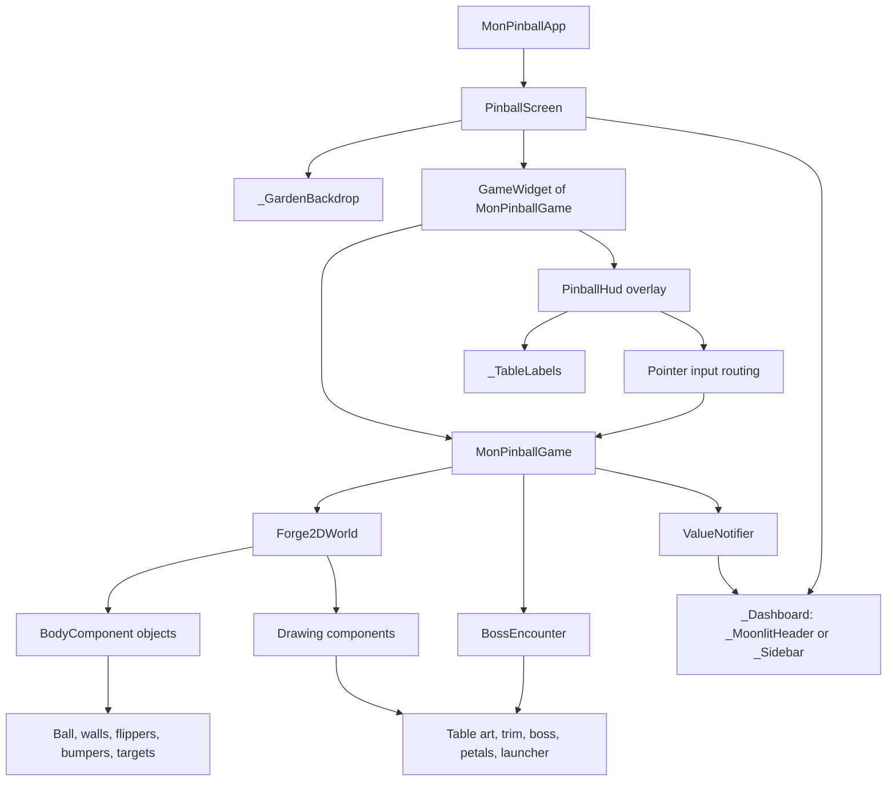
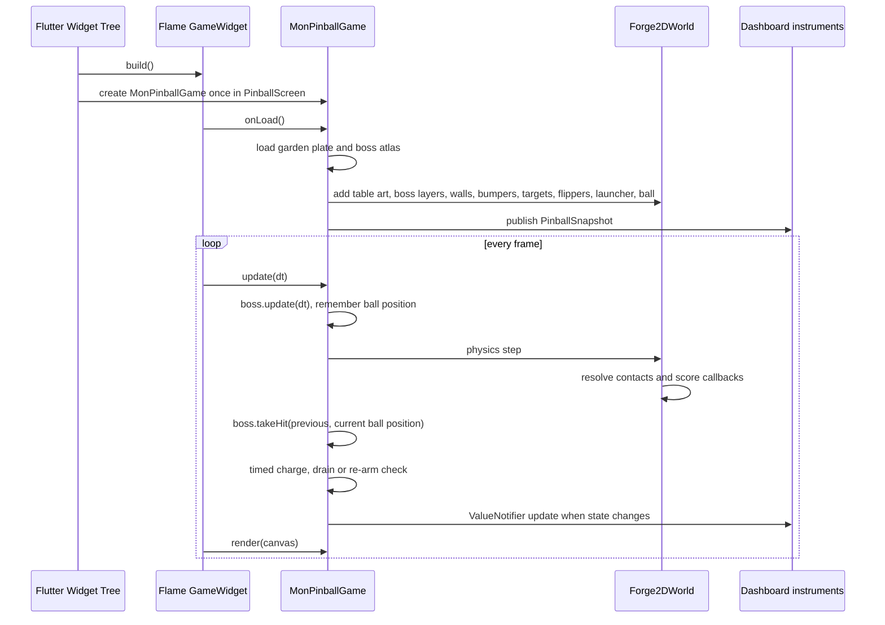
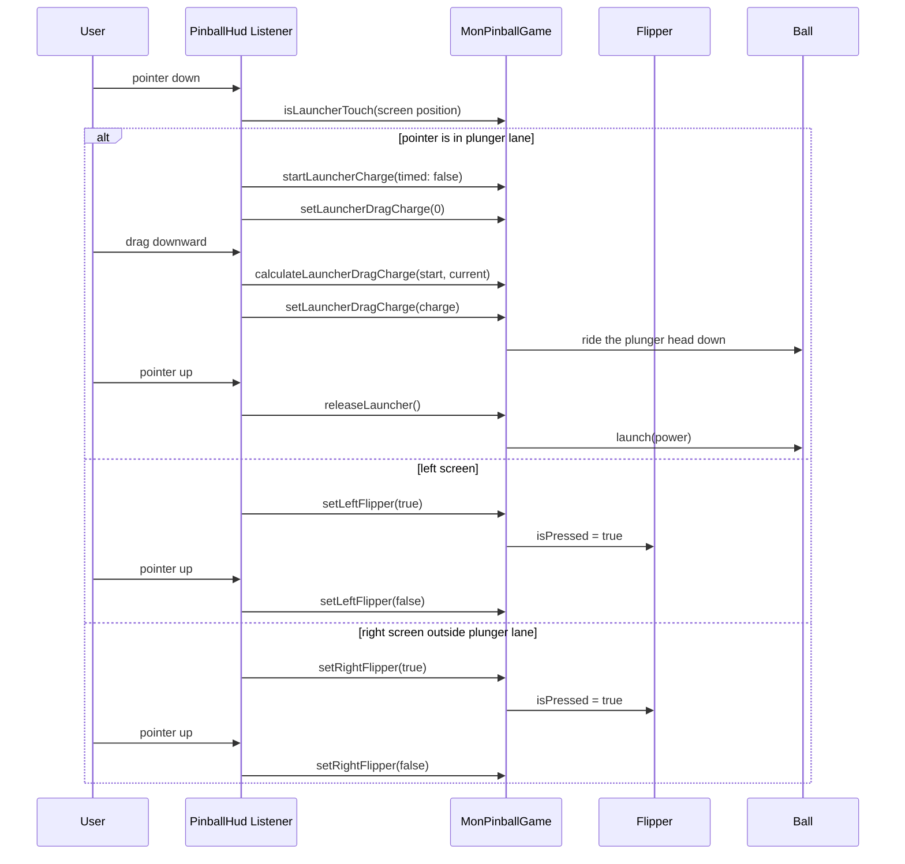
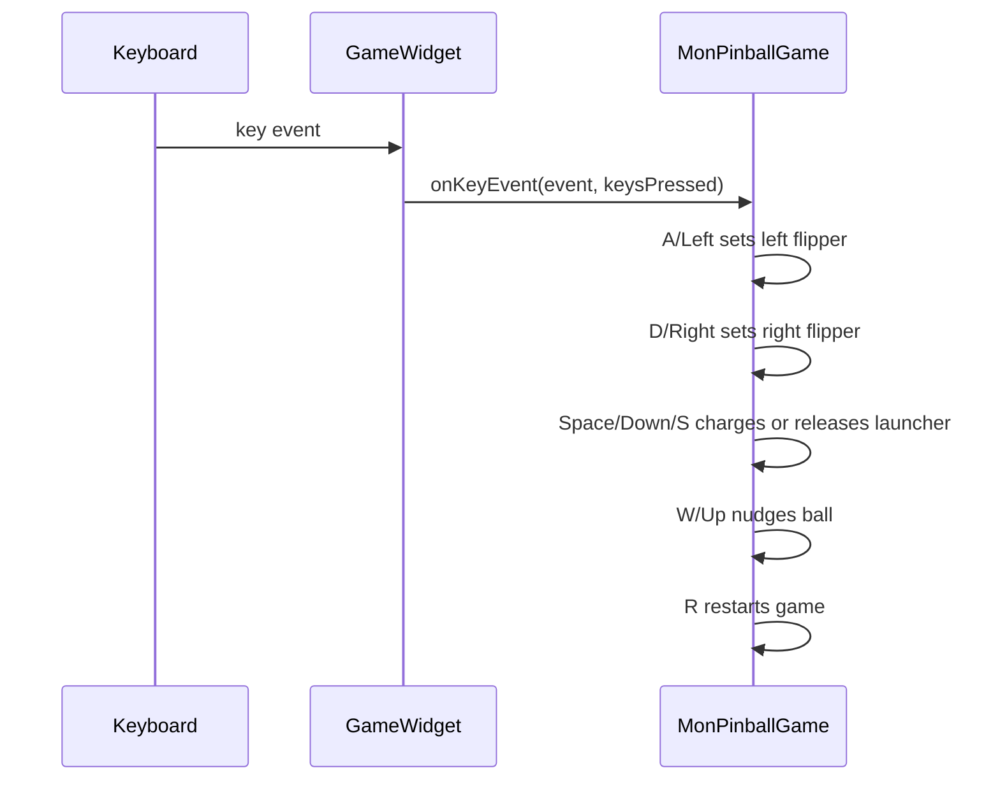
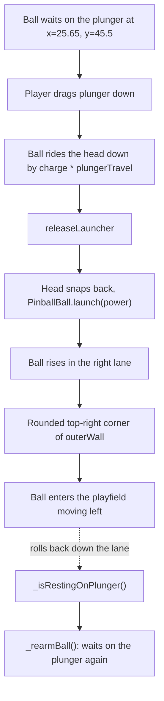
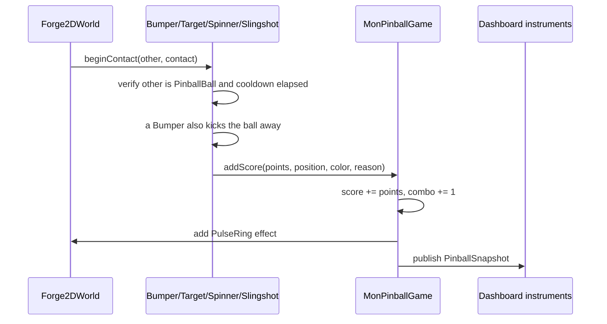
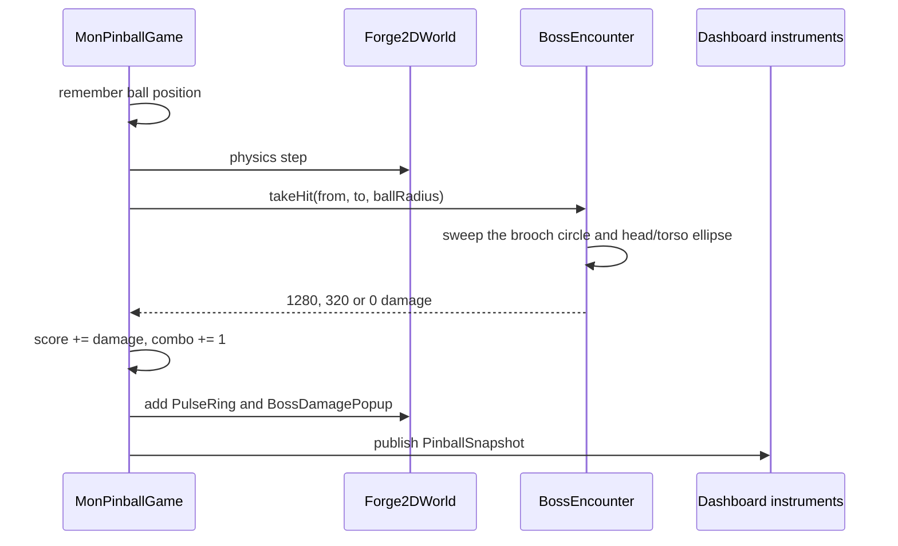
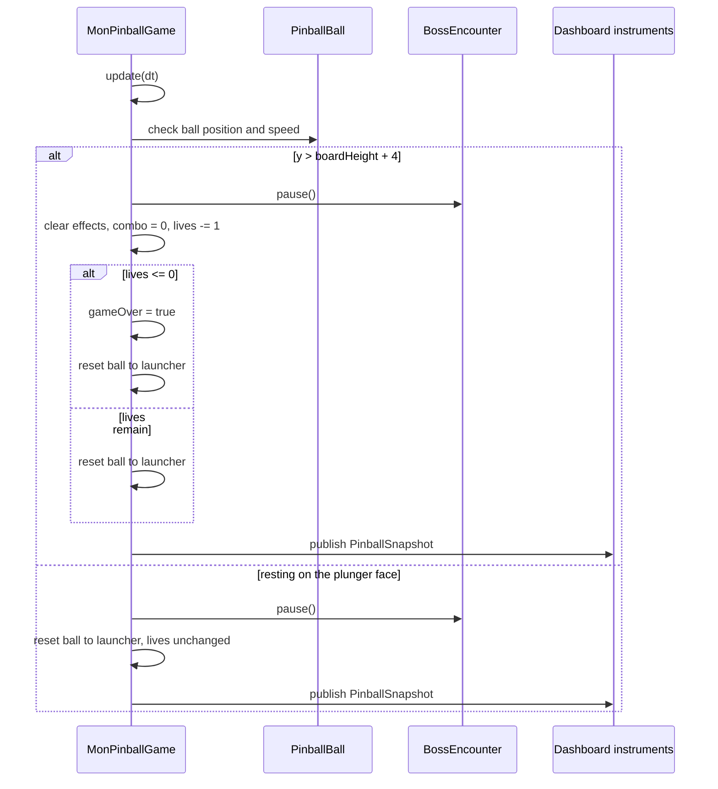

# Mon Pinball

[English](README.md) | [한국어](README.ko.md)

Flutter, Flame, Forge2D로 만든 작은 핀볼 게임입니다. Flutter는 앱의 기본 화면,
터치 입력, 헤드업 디스플레이(Head-Up Display, HUD: 점수·남은 공·상태·발사 충전
계기판)를 담당합니다. Flame/Forge2D는 게임 루프와 물리 월드를 담당합니다.

## 실행

```sh
flutter pub get
flutter run
```

## 조작

- 화면 왼쪽 터치: 왼쪽 플리퍼
- 발사 레인을 제외한 화면 오른쪽 터치: 오른쪽 플리퍼
- 오른쪽 발사 레인을 아래로 끌었다 놓기: 공 발사
- 키보드: `A`/왼쪽 방향키는 왼쪽 플리퍼, `D`/오른쪽 방향키는 오른쪽 플리퍼,
  `Space`/아래 방향키는 발사, `W`/위 방향키는 흔들기, `R`은 다시 시작
- 발사 레인으로 다시 굴러 내려온 공은 공을 잃지 않고 발사대 위에 멈추며
  다시 발사할 수 있습니다.

## 화면 디자인

달빛 정원 디자인은 남색 연못 배경, 등꽃, 금색 레일, 청록·분홍·금색 보석
범퍼와 아이보리 공을 사용합니다. 정적 배경과 투명한 보스 부위 이미지는
앱에 포함하며 [그림 제작 기록](assets/images/moonlit/ARTWORK.md)에 출처를
남겼습니다. 28 x 56 게임판은 승인된 세로 시안을 따르고, 정원 배경이 게임판
바깥 화면도 감쌉니다. 보스는 물리 장애물 아래의 독립 레이어에 떠 있어 보석
범퍼·타깃·공이 보스 위에서 잘 보이며, 꽃잎 탄은 장애물 위에 그립니다. 청록
범퍼·달 문양·플리퍼 사이 틈은 같은 가로 중심을 사용하고, 플리퍼의 실제 충돌
영역과 보이는 면을 일치시켰습니다. 달 문양 자체가 범퍼이고 금색 기둥 두 개가
가운데 빈 공간을 나누어 공이 빈 곳을 오래 가로지르지 않습니다. 위쪽 보석
범퍼 사이는 공 하나가 겨우 지나는 폭입니다.

휴대폰 GPU에서 매 프레임 별도 렌더링이 필요한 블러 마스크, 셰이더 마스크,
흐린 글자 그림자는 쓰지 않습니다. 빛 번짐은 겹친 선이나 미리 만든 그라데이션으로
그리고, 움직이지 않는 게임판 그림은 화면 해상도로 한 번 그려 둔 이미지를
다시 씁니다.

왼쪽 안내 레일, 둥근 천장, 오른쪽 벽과 발사 레인 바닥은 끊김 없는 하나의
벽으로 이어지며, 레인 안쪽 벽은 오른쪽 인레인 레일과 바로 연결됩니다. 인레인
레일은 각 플리퍼 바로 위에서 끝나고, 슬링샷과 짝을 이룬 타깃은 공 하나가
지날 폭을 남기며, 오른쪽 모서리는 레인 벽에 맞붙어 있습니다. 게임판 전체에
공을 놓아 보는 검사가 발사대 외의 곳에서 공이 멈추면 실패합니다.

세로 화면은 시안의 상단 계기판을 따릅니다. 제목·점수·다시 시작, 남은 공·상태
문구·발사 충전·콤보, 보스 체력 막대를 합쳐 휴대폰 높이의 약 13%만 사용합니다.
폭이 350 px보다 좁으면 상태 문구를 계기판의 별도 줄에 둡니다. 플리퍼와 발사
안내는 게임판에 직접 표시합니다. 넓은 창이나 휴대폰 가로 화면에서는 계기판을 오른쪽에
배치합니다. 배치가 바뀌어도 게임 인스턴스를 유지하고, 터치 좌표는 게임판
내부 좌표를 사용합니다. 화면 높이가 짧거나 글자를 크게 설정한 경우 계기판만
할당된 공간 안에서 스크롤하므로 게임판이 계속 보이고 조작할 수 있습니다.
상태 문구는 줄바꿈하며, 점수는 최소 8자리를 유지하고 더 긴 숫자는 폭에 맞춰
축소합니다. 다시 시작 버튼에는 동작을 명시한 문구를 사용합니다.

이전 `_GlassPanel`은 상단의 점수, 남은 공·상태·충전, 다시 시작 패널과 하단
조작 안내를 감쌌습니다. 반투명한 어두운 배경, 둥근 모서리, 옅은 흰색 테두리,
그림자로 유리 느낌을 냈으며, 뒤쪽 화면을 흐리는 효과는 없었습니다.
현재 `_InstrumentPanel`은 넓은 화면의 계기판에 불투명한 어두운 배경과 얇은
테두리를 사용합니다. 세로 화면은 `_MoonlitHeader`로 계기판을 줄여
게임판 공간을 확보합니다.

### 보스전

츠키비나는 위쪽 보석 범퍼 위를 날아다닙니다. 몸통·날개·소매·치맛자락을 따로
움직여 호흡, 이동의 지연, 공격 준비와 복귀, 피격 반동을 표현하며, 각 부위는
그려진 원래 비율을 유지합니다.
공이 금색 가슴 장식(명치)을 통과하면 1,280의 치명타를, 머리나 몸통에 맞으면
320의 피해를 줍니다. 치마와 소매는 판정에 들어가지 않아 그 아래 범퍼에서 공이
튀어도 체력이 깎이지 않습니다. 두 판정 모두 공의 속도를 바꾸지 않습니다. 시작 체력은 16,000입니다. 체력은 퍼센트
숫자 없이 바로 표시하고, 화면 읽기에는 수치를 제공합니다. 득점하면 콤보가
증가하고 공을 잃으면 콤보는 초기화되지만 보스에게 준 피해는 유지됩니다.
다시 시작하면 보스와 게임 상태가 모두 초기화됩니다.

첫 탄 패턴은 곡선을 그리는 보라색 꽃잎 두 갈래입니다. 현재 꽃잎은 물리
효과가 없는 방해용 연출입니다. 발사 뒤에만 공격을 시작하며, 공 소실·재시작·
격파 시 탄을 정리합니다. 보스를 격파하면 남은 공을 보존하고 재도전할 수
있습니다. 격파하면 1.4초 동안 가슴 장식이 빛난 뒤 떠오르며 사라지는 퇴장
연출을 마치고, 다시 시작할 때까지 게임판에서 제거됩니다. 고난도 물리 탄과
등장 연출은 후속 범위입니다.

### 폰트와 라이선스 출처

| 용도 | 폰트와 원본 출처 | 포함한 라이선스 |
| --- | --- | --- |
| 제목 | [Rajdhani SemiBold](https://github.com/google/fonts/tree/main/ofl/rajdhani) | [Rajdhani-OFL.txt](assets/fonts/Rajdhani-OFL.txt) |
| 화면 문구와 보조 숫자 | [IBM Plex Mono Medium](https://github.com/IBM/plex) | [IBMPlexMono-LICENSE.txt](assets/fonts/IBMPlexMono-LICENSE.txt) |
| 컴퓨터에서 실행하는 테스트 전용 | [Nanum Gothic](https://github.com/google/fonts/tree/main/ofl/nanumgothic) | [NanumGothic-OFL.txt](test/fonts/NanumGothic-OFL.txt) |

제품 폰트와 라이선스 파일은 `design/fonts/`의 원본을 수정 없이
`assets/fonts/`로 복사했습니다. 라이선스 파일은 폰트 제작자가 제공한 고지입니다.
동봉한 SIL Open Font License(OFL) 1.1의 제2항은 폰트를 재배포할 때 저작권
고지와 라이선스를 함께 포함하도록 규정합니다. 제품 폰트의 라이선스는
`pubspec.yaml`에도 앱 자산으로 등록했습니다.

한글은 시스템의 산세리프 대체 폰트를 사용합니다. 골든 테스트는 시스템 폰트가
없어도 한글을 읽을 수 있도록 `test/fonts/`의 나눔고딕을 로드합니다. 이 테스트용
폰트는 앱에 포함하지 않습니다. Git 추적에서 제외한 `design/` 폴더는 참고 자료이며
게임을 빌드하거나 실행하는 데 필요하지 않습니다.

## 작업 규칙

사람과 AI 에이전트가 따르는 브랜치·커밋·병합 규칙은 [AGENTS.md](AGENTS.md)에
있습니다.

## 검증

정적 분석, 테스트, 디버그 Android Application Package(APK, 안드로이드 설치 파일)
빌드를 실행합니다.

```sh
flutter analyze
flutter test
flutter build apk --debug
```

### 테스트 구성

Android Studio의 실행 설정에서 `Pinball - All Tests`,
`Pinball - Controls Tests`, `Pinball - Golden Tests`를 선택하면
컴퓨터의 Flutter 테스트 러너로 실행됩니다. 게임을 직접 플레이할 때는
기존 `main.dart` 실행 설정을 사용하세요.

테스트 파일을 기기 대상으로 실행하면 테스트가 실행되는 동안만 게임 화면이
표시됩니다. 실행이 끝난 뒤에는 플레이 가능한 게임 화면이 남지 않습니다.
기기에서 조작 테스트를 실행할 수 있지만, 골든 테스트는 화면만 렌더링하고
이미지 비교를 명시적으로 건너뜁니다. 기준 이미지와의 실제 비교는 컴퓨터에서
`Pinball - Golden Tests` 또는 `flutter test --tags golden`으로 실행하세요.
테스트용 폰트는 컴퓨터에서만 로드하므로 기기에는 추가 테스트 자산이 필요 없습니다.

```sh
# Gherkin 시나리오만 실행
flutter test --tags gherkin

# 골든 이미지 비교만 실행
flutter test --tags golden

# 의도적으로 화면을 변경한 뒤 골든 기준 이미지 갱신
flutter test test/golden/pinball_screen_golden_test.dart --update-goldens

# .feature 파일을 수정한 뒤 Dart 위젯 테스트 재생성
dart run build_runner build
```

골든 테스트는 실제 Flame/Forge2D 게임판을 `390 x 844` 크기로 렌더링해 초기
계기판, 발사대 충전, 게임 종료 화면을 검사합니다. `1280 x 800` 데스크톱
배치와 8자리 점수가 표시된 `320 x 740` 좁은 화면도 검사합니다. 동봉한 폰트로
글자 모양을 일정하게 유지하고 읽을 수 있게 합니다. 위젯 테스트는 큰 글자,
작은 가로 화면, 화면 배치 변경 시 게임 상태 유지, 크기 변경 후 발사대 입력을
검증합니다. `test/table_traps_test.dart`는 레인으로 돌아온 공이 발사대에 다시
놓이는지와 공이 멈춰 끼는 곳이 없는지 검사합니다. 게임판 테스트는 양쪽 플리퍼의
가장 바깥 끝으로 공을 쳐 보고, 모든 범퍼·달·금색 기둥에서 공이 튀며 점수가
오르는지 확인합니다. `test/render_budget_test.dart`는 정적인 게임판 그림을 프레임마다
재사용하는지와 그리기 코드에 블러·마스크가 다시 들어오지 않았는지 검사합니다.

점수 비교용 골든 이미지는 같은 `390 x 844` 화면에서 8자리(`12,345,678`),
9자리(`123,456,789`), 네이티브 정수형의 최댓값인 19자리
(`9,223,372,036,854,775,807`)를 표시합니다. 마지막 예시는 Android 및
네이티브 Dart의 표시 한계를 확인하기 위한 것으로 게임의 점수 상한을 추가하지
않습니다. 이미지는 `test/golden/goldens/`의 `pinball_score_8_digits.png`,
`pinball_score_9_digits.png`, `pinball_score_19_digits.png`입니다.

Gherkin 시나리오의 원본은 `test/features/pinball_controls.feature`입니다.
`bdd_widget_test`가 해당 Flutter 위젯 테스트를 생성하며, 재사용하는 단계별
구현은 `test/steps/`에 있습니다. 시나리오는 초기 계기판, 양쪽 플리퍼의 터치
조작, 발사대 끌기·놓기, 다시 시작, 키보드 흔들기를 검증합니다.

`test/pinball_physics_test.dart`는 실제 Forge2D 물리 시간을 진행시켜 발사 전
대기, 충전, 공 소실, 다시 시작, 최소 발사력으로 레인 출구 통과, 비행 중 발사대
연타가 공에 영향을 주지 않는 동작을 검증합니다.

보스 공격·피격·격파 화면도 골든 기준 이미지로 검증합니다.
보스 테스트는 시간에 따른 동작, 빠른 공의 약점 통과, 접촉 중 중복 피해 방지,
실제 게임의 발사·공 소실·격파 정리, 부위별 렌더링, 체력 접근성, 중심 정렬,
범퍼 통로와 플리퍼의 보이는 충돌 면을 검증합니다. 이미지 디코딩은 테스트의
가상 시간 밖에서 수행하고, 물리 시간은 테스트가 직접 진행시킵니다.

## 프로젝트 구조

```text
lib/
  main.dart           Flutter 앱, 정원 배경, 반응형 계기판, 게임 호스트, 터치 입력
  pinball_game.dart   Flame/Forge2D 게임, 물리 바디, 점수 계산, 보스 타격, 발사대
  pinball_style.dart  공통 색상, 재질 그리기, 접근성을 지원하는 도트 점수판, 남은 공·체력 표시
  boss_encounter.dart 시간 기반 보스 동작, 체력, 타격 판정 영역과 꽃잎
  moonlit_boss.dart   부위별로 따로 움직이는 보스 그림과 꽃잎
  moonlit_table.dart  미리 그려 두는 정원 게임판, 금색 장식, 달·기둥·보석 그리기

assets/
  fonts/              제품 폰트와 라이선스
  images/moonlit/     정원, 투명 보스 부품 그림과 제작 기록

test/
  features/           Gherkin 시나리오와 생성한 Flutter 위젯 테스트
  fonts/              컴퓨터 테스트 전용 폰트와 라이선스
  golden/             골든 테스트와 저장소에 포함하는 기준 이미지
  steps/              실행 가능한 Gherkin 단계 구현
  support/            공통 게임·위젯 테스트 환경
  widget_test.dart    반응형 배치, 접근성, 입력 회귀 테스트
```

## 아키텍처

Android 개발자 관점으로 보면 `main.dart`는 화면 표시·입력 레이어를 가진
Activity/Fragment에 가깝고, `pinball_game.dart`는 물리 엔진을 가진 사용자 정의
게임 뷰에 가깝습니다. `boss_encounter.dart`는 보스 그림과 타격 판정이 함께 읽는
상태 객체이고, `moonlit_*.dart` 파일은 그리기만 담당합니다.



### 레이어별 역할

| 레이어 | 파일 | 역할 |
| --- | --- | --- |
| 앱 기본 화면 | `lib/main.dart` | `MaterialApp`, 화면 구성, `GameWidget` 연결 |
| 배경 | `lib/main.dart` | `_GardenBackdrop`이 화면 전체 뒤에 어둡게 처리한 정원 그림을 그림 |
| 계기판 | `lib/main.dart` | `_Dashboard`가 게임 표시 영역 밖에 점수·남은 공·콤보·보스 체력·상태·발사 충전 표시 |
| 터치 입력 | `lib/main.dart` | 포인터 누르기·이동·놓기, 발사대 끌기 추적, 플리퍼 누름 상태, 게임판 안내 문구 |
| 게임 상태 | `lib/pinball_game.dart` | 점수, 콤보, 남은 공, 발사 충전, 게임 종료, 보스 타격, 계기판 상태 스냅샷 |
| 보스 상태 | `lib/boss_encounter.dart` | 보스 이동 경로, 체력, 가슴 장식·몸통 타격 판정, 공격 주기, 꽃잎 |
| 물리 월드 | `lib/pinball_game.dart` | Forge2D 중력, 바디, 충돌 도형, 충돌 콜백 |
| 게임판 렌더링 | `lib/moonlit_table.dart`, `lib/pinball_game.dart` | 미리 그려 둔 정원 그림과 금색 장식, 각자 스스로를 그리는 벽·범퍼·슬링샷·플리퍼·공·효과 |
| 보스 그림 | `lib/moonlit_boss.dart` | `BossEncounter`에 맞춰 움직이는 여섯 부위 그림, 장식용 꽃잎 |
| 공통 스타일 | `lib/pinball_style.dart` | 색상, 금속·유리 재질, `DotMatrixScore`, `LivesIndicator`, `HealthBar`, `CrescentMark` |

### 화면 표시와 입력 레이어

`PinballScreen`은 `Scaffold` 안의 `Stack`에서 `_GardenBackdrop`을 가장 먼저
그립니다. 배경은 `SafeArea` 바깥까지 화면 전체를 채우므로 노치와 시스템
표시줄 주변도 정원 그림이 감쌉니다. `_GardenBackdrop`은 게임이 이미 불러온
`moonlit/garden.png`를 재사용하고, 그리는 호출 한 번에서 어둡게 처리합니다.
`SafeArea` 안에서는 `LayoutBuilder`가 `Flex` 방향을 정합니다. 세로 화면은
위아래로, 폭이 700 px 이상이거나 높이보다 넓으면 좌우로 배치합니다. 방향만
바뀌므로 `GameWidget`과 게임 인스턴스는 배치가 바뀌어도 유지됩니다. 게임은
`28 / 56` 비율의 `AspectRatio` 안에 놓입니다.

처음의 `PinballHud`는 `Stack`으로 터치 리스너와 보이는 계기판을 게임 위에
겹쳐 놓았습니다. 현재 계기판은 게임 표시 영역 밖에 있습니다. `_Dashboard`가
`MonPinballGame.hud`를 구독해 세로 화면에서는 게임판 위에 `_MoonlitHeader`를,
넓은 화면에서는 오른쪽에 `_Sidebar`를 만듭니다. 계기판은
`SingleChildScrollView` 안에 있고 세로 화면에서는 높이의 최대 42%만 쓰므로,
글자가 커지면 게임판을 줄이는 대신 계기판이 스크롤됩니다.

`PinballHud`는 게임의 `hud` 오버레이입니다. `LayoutBuilder`로 실제 게임 표시
영역의 크기를 구하고, `Stack`에서 게임판에 직접 표시하는 플리퍼·발사 안내
문구인 `_TableLabels`를 입력용 `Listener` 아래에 둡니다. 안내 문구는 포인터와
화면 읽기 정보를 무시합니다. 카메라와 같은 배율을 적용하는
`MonPinballGame.boardToViewport`로 위치를 정하므로 게임판의 정해진 자리에
놓입니다. 포인터 좌표는 게임 표시 영역 내부 좌표를 유지합니다.

## 실행 흐름

Flame은 프레임마다 `update(dt)`와 `render(canvas)`를 호출합니다. 게임
프레임워크가 Android의 `Choreographer`와 사용자 정의 `View.onDraw()`에
해당하는 호출 일정과 그리기를 관리합니다.



## 주요 클래스

### `MonPinballGame`

`MonPinballGame`은 `Forge2DGame`을 상속하는 중앙 게임 컨트롤러입니다.

역할:

- 중력 `36`을 적용한 `28 x 56`(`boardWidth` x `boardHeight`) 고정 크기의 게임판 월드 생성
- 점수, 콤보, 남은 공, 발사 충전, 상태, 게임 종료 여부와 `BossEncounter` 관리
- `ValueNotifier<PinballSnapshot>`으로 보스 체력과 콤보를 포함한 계기판 상태 전달
- Flame의 `KeyboardEvents`로 키보드 입력 처리
- 정원 그림과 보스 부위 그림을 불러온 뒤 게임판 그림, 보스 레이어, 벽, 범퍼, 표적, 플리퍼, 발사대, 공 생성
- 프레임마다 보스 타격을 판정하고, 공이 게임판 아래로 떨어졌는지와 발사대 위에 다시 멈췄는지 감지

주요 메서드:

| 메서드 | 용도 |
| --- | --- |
| `onLoad()` | 이미지 로드, 물리 월드 초기화 및 컴포넌트 생성 |
| `onGameResize()` | 고정 크기 월드를 현재 화면에 맞춤 |
| `update(dt)` | 보스 이동과 타격 판정, 시간 기반 발사 충전, 공 이탈과 발사대 복귀 감지 |
| `boardToViewport()` | 정적 메서드. 게임판 좌표를 Flutter 오버레이용 게임 위젯 좌표로 변환 |
| `isLauncherTouch()` | 화면 좌표를 월드 좌표로 변환해 발사대 영역인지 확인 |
| `calculateLauncherDragCharge()` | 아래로 끈 거리를 `0.0..1.0` 충전량으로 변환 |
| `setLauncherDragCharge()` | 끌어서 만든 충전량을 저장하고 발사대 머리와 대기 중인 공을 아래로 이동 |
| `releaseLauncher()` | 발사대에서 대기 중인 공에만 발사 속도를 적용하고 보스 공격 시작 |
| `addScore()` | 점수와 콤보 갱신 및 파동 효과 생성 |
| `restartGame()` | 점수·콤보·남은 공·공·발사대 상태와 보스 초기화 |

### `PinballHud`

`PinballHud`는 Flame 캔버스 위에 놓이는 투명한 Flutter 오버레이입니다.
반투명 입력 `Listener`(`pinball-input-surface`) 아래에 `_TableLabels`를 두며,
계기판은 포함하지 않습니다.

`PinballHud`의 포인터별 터치 입력 분배:

- 발사대 영역(`isLauncherTouch`: 게임판 `x` 24~28, `y` 38~56): 발사대 끌기
- 그 밖의 왼쪽 절반: 왼쪽 플리퍼
- 그 밖의 오른쪽 절반: 오른쪽 플리퍼

같은 쪽을 누르는 다른 포인터가 없을 때만 플리퍼를 놓고, 발사대는 마지막
포인터를 뗄 때 발사합니다. 포인터 입력은 Flutter 오버레이에서 처리하고, 게임
동작은 `MonPinballGame`에 위임합니다. 화면 관련 처리가 물리 클래스에 섞이지
않도록 분리한 구조입니다.

### 계기판

`_Dashboard`는 `ValueListenableBuilder`로 `MonPinballGame.hud`의 변경을 받아
게임판을 가리지 않고 계기판을 다시 그립니다.

- `_MoonlitHeader`(세로 화면): 제목·`DotMatrixScore` 점수·다시 시작, 남은
  공(`LivesIndicator`)·`_StatusLine`·`_ComboBadge`, `HealthBar`를 담은
  `_BossHealth` 순서입니다. 폭이 350 px보다 좁으면 `_StatusLine`을 별도 줄에
  둡니다.
- `_Sidebar`(넓은 화면): 제목과 다시 시작 아래에 점수, 남은 공과 콤보, 보스
  체력, 상태, 키보드 조작 목록을 각각 `_InstrumentPanel` 카드로 표시합니다.

`_StatusLine`은 실시간 상태 문구와 발사 충전 막대를 함께 보여 줍니다.
`_BossHealth`는 화면 읽기에 체력 수치와 콤보를 제공합니다.

### `BossEncounter`

`BossEncounter`는 자체 컴포넌트가 없는 상태 객체로, `MoonlitBoss`,
`BossPetals`, `BossWeakPoint`와 타격 판정이 모두 이 객체를 읽습니다. 시작
체력은 16,000(`maxHealth`)이며 `(14, 8.6)` 주변의 정해진 경로를 따라
움직입니다. `start()`는 발사할 때 공격 주기를 시작하고, `pause()`는 공 소실이나
발사대 복귀 때 주기를 멈추며, `reset()`은 보스전 전체를 초기화합니다.
`update(dt)`는 시간을 진행하고 장식용 꽃잎을 다시 계산합니다. `takeHit()`은
[충돌과 점수 계산](#충돌과-점수-계산)에서 설명합니다.

### 물리 컴포넌트

대부분의 게임판 객체는 `BodyComponent<MonPinballGame>`을 상속합니다.
`BodyComponent`는 Flame과 Forge2D를 연결하며, Forge2D `Body`를 소유하고
이를 렌더링하며 Flame 컴포넌트 트리에서 갱신됩니다.

| 클래스 | 바디 종류 | 용도 |
| --- | --- | --- |
| `PinballBall` | 정적, 발사 후 동적 | 반지름 `0.7`의 공. 발사대에서 대기하는 동안 정적이고 발사하면 동적 |
| `TableWall` | 정적 체인 | `ChainShape` 벽. `outerWall`(왼쪽 인레인 레일, 둥근 천장, 오른쪽 벽, 발사 레인 바닥) 또는 `laneWall`(레인 안쪽 벽에서 오른쪽 인레인 레일까지) |
| `Flipper` | 운동학적 | 끝이 가늘어지는 날. `length` 5.9, `baseRadius` 0.75, `tipRadius` 0.42이며 축 원·끝 원·그 사이 다각형으로 구성 |
| `Bumper` | 정적 원 | 점수를 주고 `kick` 충격량을 더함. `BumperStyle.jewel`, `post`, `moon`이 그림을 결정 |
| `Spinner` | 정적 다각형 | `barAngle`(왼쪽 0.5, 오른쪽 -0.5)만큼 기운 막대. 맞으면 점수를 주고 한 바퀴 회전 표시 |
| `DropTarget` | 정적 다각형 | `halfLength` 1.5의 표적. 타격 점수를 주며 제자리에 남음 |
| `Slingshot` | 정적 다각형 | 플리퍼 근처와 왼쪽 위의 삼각형 반발 구역 |

체인의 꼭짓점을 공유하므로 두 벽 조각 사이에 공이 낄 만한 틈이 생기지
않습니다. `outerWall`의 마지막 점이 `laneWall` 위에 있어 레인 바닥이 닫힙니다.

### 그리기 전용 컴포넌트

다음 컴포넌트는 Flame `Component` 또는 `PositionComponent`를 상속하며 물리
바디가 없습니다. Flame은 `priority`가 낮은 것부터 그리며, 물리 객체는 그
사이에 놓입니다. `TableWall` -10, `Slingshot` 1, `Spinner`와 `DropTarget` 4,
`Bumper` 5, `Flipper` 10, `PinballBall` 80입니다.

| 클래스 | 우선순위 | 용도 |
| --- | --- | --- |
| `MoonlitTable` | -100 | 정원 그림, 안내선, 금색 테두리를 `bakedArt`로 한 번 그려 두고 이미지 하나로 다시 그림 |
| `MoonlitBoss` | -20 | 장애물 아래에 그리는 츠키비나의 여섯 부위 |
| `TableTrim` | -8 | 위쪽 가장자리 위의 금색 아치, 레일 리벳, 레인 안쪽 벽 끝의 장식 |
| `LauncherView` | 15 | 발사대 몸체, 압축되는 용수철, 충전 눈금 |
| `BossWeakPoint` | 40 | 가슴 장식 판정 원의 윤곽 |
| `PulseRing` | 50 | 일시적인 점수 타격 효과 |
| `BossPetals` | 60 | 장애물 위, 공 아래에 그리는 장식용 꽃잎 |
| `BossDamagePopup` | 120 | 떠오르는 피해 숫자 |

`MoonlitTable`은 캔버스 배율에 기기 픽셀 비율을 곱한 해상도로 그림을 만들고,
그 배율이 0.5보다 크게 바뀔 때만 다시 만듭니다. `test/render_budget_test.dart`는
`bakedArt`로 프레임 사이에 같은 이미지를 재사용하는지 검사합니다.

## 입력 흐름

### 터치: 플리퍼와 발사대



### 키보드



## 발사대 알고리즘

모바일 발사대는 누른 시간 대신 끈 거리를 사용합니다. 실제 스프링을 당기는
느낌에 가깝게 조작하도록 한 선택입니다.
머리 부분이 고정된 받침대 쪽으로 내려가면서 용수철이 압축되고, 대기 중인 공도
머리에 올라탄 채 최대 `plungerTravel`(게임판 단위 2.2)만큼 함께 내려갑니다.
충전과 발사는 대기 중인 공에만 적용되며, 비행 중에는 발사대를 조작해도
충전·재발사·추가 추진이 발생하지 않습니다. 게임 종료나 보스 격파 뒤에
발사대를 누르면 대신 게임을 다시 시작합니다.

```text
onPointerDown(position):
  if isLauncherTouch(position):
    remember drag start position
    startLauncherCharge(timed: false)
    setLauncherDragCharge(0)
  else if x is left half:
    press left flipper
  else:
    press right flipper

onPointerMove(position):
  if current action is launcher and ball is waiting:
    startWorld = screenToWorld(dragStart)
    currentWorld = screenToWorld(position)
    charge = clamp((currentWorld.y - startWorld.y) / 6.2, 0, 1)
    update HUD charge and LauncherView.charge
    ball.position = launchPosition + Vector2(0, charge * plungerTravel)

onPointerUp:
  if current action is launcher and ball is waiting:
    power = max(charge, 0.2)
    reset charge to 0
    ball.position = launchPosition   // the head snaps back
    ball.velocity = Vector2(0, -(57.5 + 42.5 * power))
    ball.angularVelocity = 18 * power
    boss.start()
```

공의 바디가 정적인 동안을 대기 중으로 봅니다. 따라서 발사 속도는 최소
출력에서 초당 66, 최대 충전에서 초당 100 게임판 단위이며, 중력은 36입니다.
키보드 발사(`Space`, 아래 방향키, `S`)는 끈 거리 대신 누른 시간을 사용해,
키를 누르는 동안 초당 0.8씩 충전하고 키를 떼면 발사합니다.

`currentWorld.y - startWorld.y`를 사용하는 이유:

- 게임판 좌표에서 `y`가 클수록 아래쪽입니다.
- 손가락을 아래로 끌면 `y`가 증가합니다.
- 이 차이를 스프링의 당김 강도에 자연스럽게 대응시킬 수 있습니다.

## 공 발사와 레인 출구

발사 레인 `MonPinballGame.launchLane`은 `x = 24.4`의 `laneWall`과
`x = 26.9`의 오른쪽 벽 사이에 있으며, `y = 21`부터 `y = 46.2`의 발사대 면까지
이어집니다. 이 면은 `outerWall`의 마지막 선분이므로 레인 바닥은 바깥 벽의
일부입니다. 공은 그 면 위의 `launchPosition`, 즉 `(25.65, 45.5)`에 정적
바디로 대기합니다. 처음 시작하거나 공을 잃거나 다시 시작한 뒤에도 발사
전까지 고정됩니다.

발사된 공은 레인을 따라 올라갑니다. `y = 21` 위에서는 안쪽 벽이 끝나고, 공은
오른쪽 벽을 따라 `outerWall`의 둥근 오른쪽 위 모서리(반지름 4의 호)에 닿아
왼쪽 게임판으로 방향을 바꿉니다. 출구 센서나 추가 충격량은 없으며, 방향
전환은 일반적인 벽 충돌입니다. `test/pinball_physics_test.dart`는 최소 출력과
최대 출력 모두 공을 게임판 안으로 보내는지 검사합니다.



나중에 레인으로 다시 굴러 내려온 공은 발사대 면 위에 멈춥니다.
`_isRestingOnPlunger()`는 매 프레임 동적인 공이 `x = 24.4`보다 오른쪽에 있고,
대기 높이보다 0.3 미만으로 위에 있으며, 초당 1.5보다 느린지 확인합니다.
조건을 만족하면 `_rearmBall()`이 보스 공격을 멈추고, 공을 잃지 않은 채 정적인
대기 상태로 되돌립니다.

## 충돌과 점수 계산

Forge2D의 접촉 콜백은 `ContactCallbacks`로 전달됩니다. 점수를 주는 객체는
`ContactCallbacks`를 믹스인하고 `beginContact`를 구현합니다.



| 객체 | 점수 | 재작동 대기 | 비고 |
| --- | --- | --- | --- |
| 위쪽 보석 범퍼(금색, 분홍) | 250 | 0.18초 | `BumperStyle.jewel`, kick 22 |
| 가운데 선의 청록 보석 범퍼 | 400 | 0.18초 | `BumperStyle.jewel`, kick 22 |
| 달 문양 | 300 | 0.18초 | `BumperStyle.moon`, kick 22 |
| 금색 기둥 | 100 | 0.18초 | `BumperStyle.post`, kick 16 |
| `Spinner` | 150 | 0.12초 | |
| `DropTarget` | 125 | 0.2초 | |
| `Slingshot` | 75 | 없음 | 반발 계수 1.25 |

보스 타격은 접촉 콜백을 쓰지 않습니다. 보스에는 물리 바디가 없어 공이 그대로
통과합니다. `update(dt)`가 물리 단계 전의 공 위치를 기억해 두고, 단계가 끝나면
`BossEncounter.takeHit(from, to, ballRadius: PinballBall.radius)`를
호출합니다. 이동 구간은 보스 기준 상대 좌표로 계산하므로 지난 프레임 이후의
보스 이동도 반영합니다.



- 가슴 장식(치명타): `boss.position` 주변의 반지름 `weakPointRadius` 1.35인
  원을 공 반지름만큼 넓힌 영역이며, `hitDamage` 1,280을 줍니다.
- 머리와 몸통: 가슴 장식에서 `bodyCenter` (0, -0.6)만큼 떨어진 곳을 중심으로
  반축이 `bodyRadiusX` 2.4, `bodyRadiusY` 4.4인 타원을 공 반지름만큼 넓힌
  영역이며, `bodyDamage` 320을 줍니다. 치마와 소매는 이 타원 밖에 있습니다.
- 두 영역을 함께 지나면 치명타로 계산합니다. 각 영역은 공이 영역 밖에서
  단계를 마칠 때까지 이어지는 겹침을 한 번만 셉니다.
- 피해는 남은 체력을 넘지 않고 점수에 더해지며, 공의 속도는 바꾸지 않습니다.
  보스가 활성화된 동안, 즉 발사한 뒤부터 공 소실·발사대 복귀·격파 전까지만
  판정합니다.

점수 계산의 보호 장치:

- 범퍼, 스피너, 표적은 짧은 재작동 대기 시간(0.18, 0.12, 0.2초)으로 한 번의
  접촉에서 점수가 과도하게 반복되는 것을 방지합니다.
- `addScore()`는 게임 종료나 보스 격파 뒤의 타격을 반영하지 않습니다.
- 타격 효과는 별도 `PulseRing` 컴포넌트이므로 점수 계산이 화면 오버레이의
  렌더링에 의존하지 않습니다. 공 소실과 다시 시작 시 남아 있는 파동 효과와
  피해 숫자를 정리합니다.
- 콤보는 득점할 때마다 늘고 공 소실이나 다시 시작 시 초기화됩니다. 발사대로
  돌아온 공은 콤보를 유지합니다.

## 플리퍼 알고리즘

플리퍼는 Forge2D의 운동학적 바디입니다. 현재는 회전 관절 대신 각속도를
설정해 목표 각도로 회전시킵니다.

각 플리퍼는 가운데 선 `x = 14` 양쪽의 `(6.6, 52.3)`과 `(21.4, 52.3)`을 축으로
하는, 끝이 가늘어지는 날입니다. 왼쪽 플리퍼는 0.44에서 대기하다 -0.42까지
올라가고, 오른쪽 플리퍼는 좌우 대칭입니다. 날의 세 충돌 도형인 축 원, 끝 원,
두 원의 바깥 접선을 잇는 다각형은 보이는 윤곽과 일치합니다.

```text
update(dt):
  targetAngle = isPressed ? activeAngle : restAngle
  delta = targetAngle - currentAngle

  if abs(delta) < 0.025:
    angularVelocity = 0
    snap transform to targetAngle if world is not locked
  else:
    angularVelocity = clamp(delta * 24, -24, 24)
```

절충점:

- 첫 버전에서 사용하기에 단순하고 충분히 안정적입니다.
- 더 사실적인 물리 반응이 필요하면 Forge2D `RevoluteJoint`와 모터 제한으로
  교체할 수 있습니다.

## 공 이탈과 초기화 흐름



## 좌표계

게임은 고정 크기의 월드를 사용하고 화면 크기에 맞춰 카메라 배율을 조정합니다.

```text
월드 크기: 28 x 56 (MonPinballGame.boardWidth x boardHeight)
원점: 게임판의 왼쪽 위 모서리
x는 오른쪽으로 증가
y는 아래쪽으로 증가
카메라: 게임판 중앙 (14, 28)에 위치
배율: min(screenWidth / 28, screenHeight / 56) * 0.96 (boardFill)
```

물리 설정은 휴대폰 해상도에 영향을 받지 않습니다. `PinballScreen`은
`GameWidget`에 게임판과 같은 `28 / 56` 비율을 주고, `boardFill`은 게임판
가장자리 바로 바깥에 그리는 금색 장식을 위한 여백을 남깁니다. 발사 레인 판정
시 Flutter의 포인터 위치를 월드 좌표로 변환합니다. 반대 방향으로는
`MonPinballGame.boardToViewport()`가 같은 배율을 적용해 `_TableLabels`가
게임판 위에 안내 문구를 놓습니다. 청록 범퍼, 달 범퍼, 플리퍼 사이 틈은 같은
가운데 선 `x = 14`(`MoonlitTable.centerX`)를 사용합니다.

## 현재 제약

- 플리퍼는 관절 모터 대신 각도로 제어하는 운동학적 바디입니다.
- 아직 소리가 없습니다.
- 이미지는 정원 배경과 보스 부위 그림뿐이며, 게임판 객체는 Canvas 기본 도형으로 그립니다.
- 게임판 배치는 월드 좌표로 코드에 직접 지정되어 있습니다.
- 표적은 점수를 주지만 쓰러지지 않습니다.
- 보스 꽃잎은 장식이며 공과 충돌하지 않습니다.
- Forge2D 회귀 테스트는 발사, 공 이탈, 발사대 복귀, 범퍼 점수를 검증하며,
  스피너·표적·슬링샷 점수는 아직 테스트로 다루지 않습니다.

## 향후 개선 후보

1. 게임판이 커지면 `pinball_game.dart`를 `components/`, `input/`, `state/`로 분리
2. 더 사실적인 물리 반응을 위해 플리퍼에 `RevoluteJoint`와 모터 제한 적용
3. `flame_audio`로 소리 효과 추가
4. 재현 가능한 Forge2D 물리 테스트를 스피너·표적·슬링샷 점수 검증으로 확장
5. 컴포넌트 코드를 수정하지 않고 레벨을 조정할 수 있도록 `outerWall`, `laneWall`, 범퍼 목록 같은 게임판 좌표를 데이터로 분리

## 최초 커밋 체크리스트

```sh
flutter analyze
flutter test
git init
git add .
git commit -m "Initial Flame pinball game"
```
