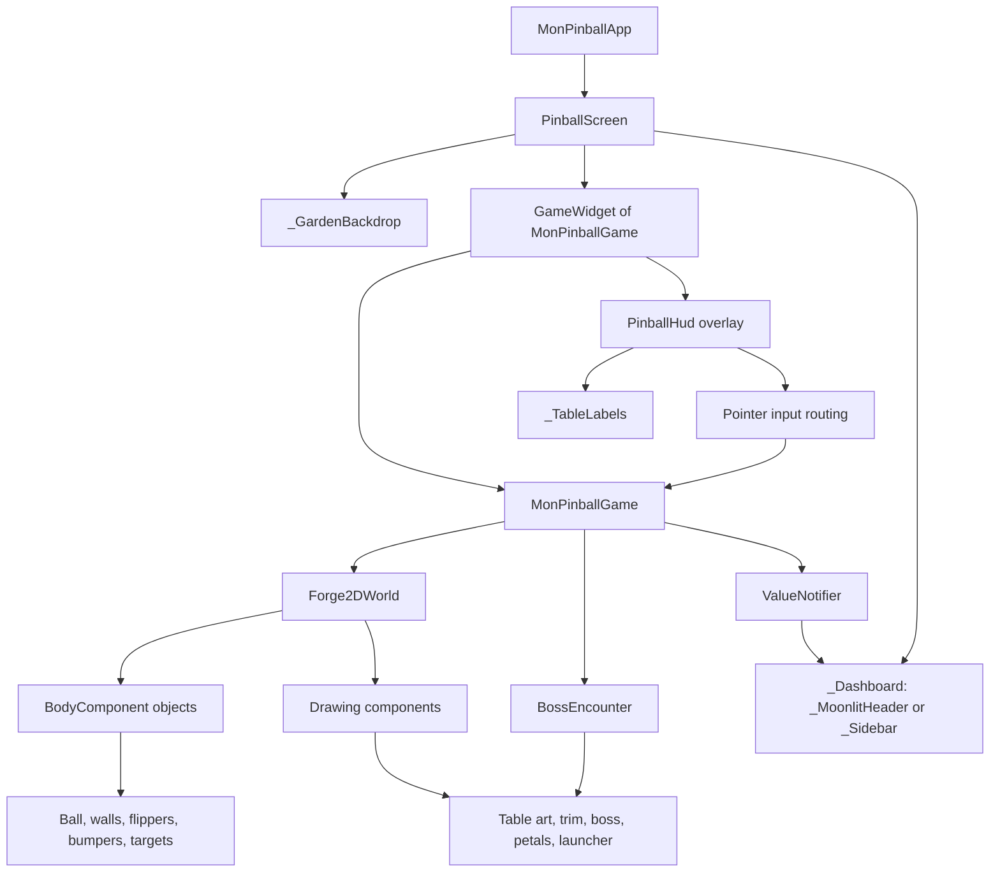
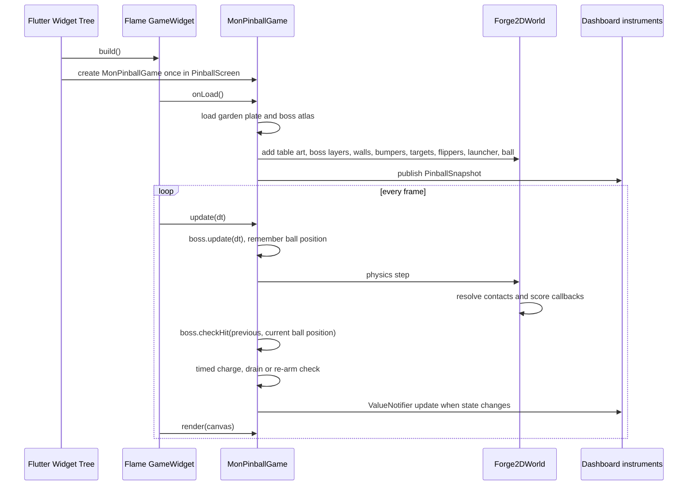
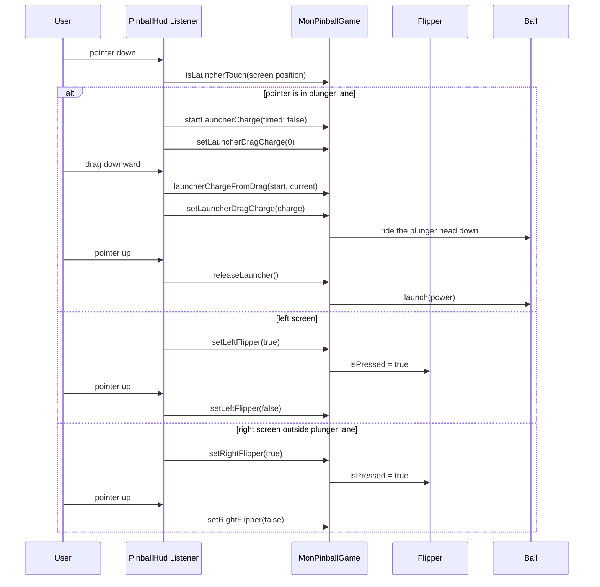
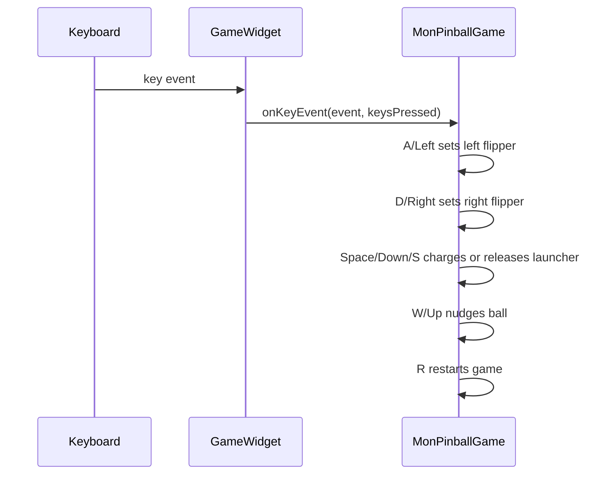
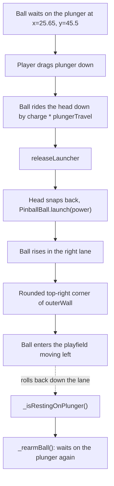
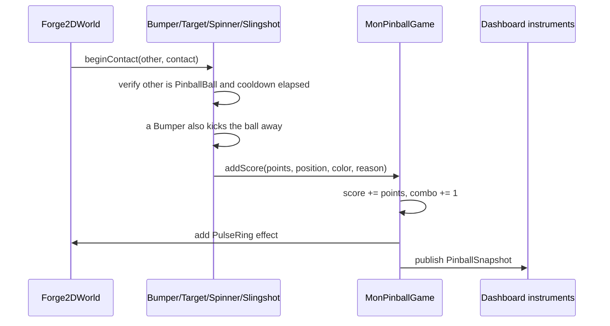
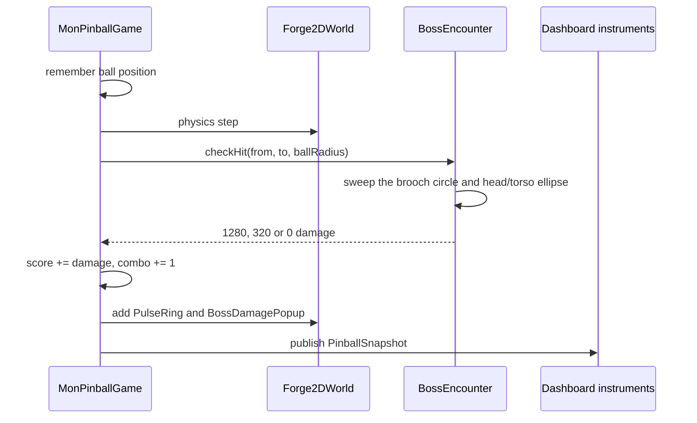
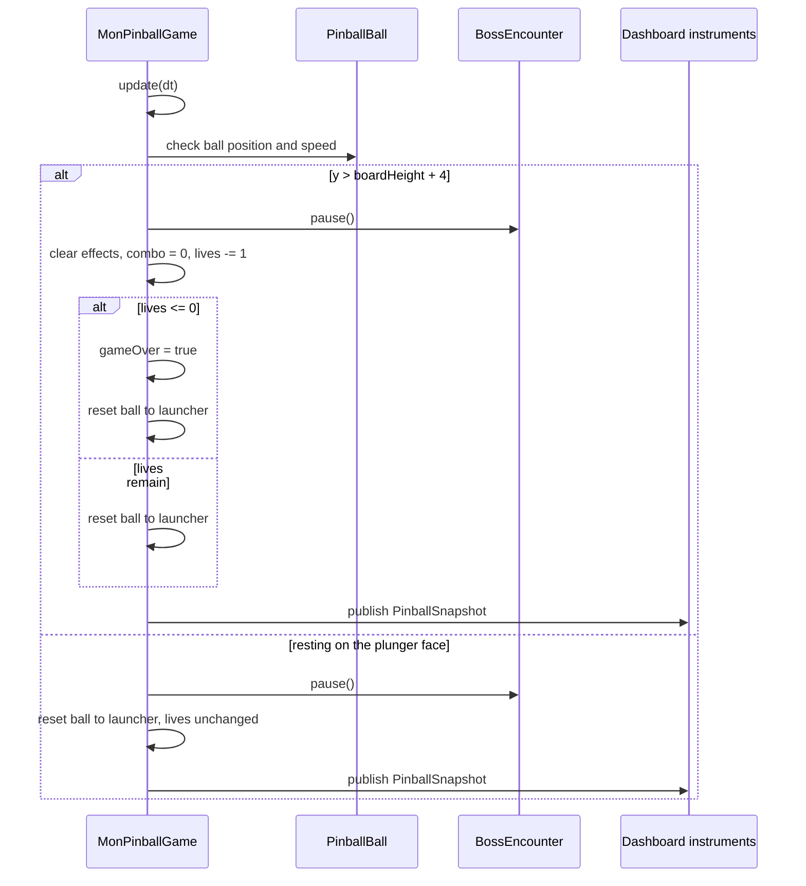

# Mon Pinball

[English](README.md) | [한국어](README.ko.md)

A small pinball game built with Flutter, Flame, and Forge2D. Flutter handles
the app shell, touch input, and the heads-up display (HUD): score, remaining
balls, status, and launch charge. Flame/Forge2D handle the game loop and
physics world.

## Run

```sh
flutter pub get
flutter run
```

## Controls

- Touch left side: left flipper
- Touch right side outside the plunger lane: right flipper
- Drag the right plunger lane downward, then release to shoot
- Keyboard: `A`/left arrow, `D`/right arrow, `Space`/down arrow to launch, `W`/up arrow to nudge, `R` to restart
- A ball that rolls back down the plunger lane rests on the plunger and can be
  launched again without losing it

## Visual Design

The moonlit garden design combines midnight-indigo pond art, hanging wisteria,
antique-gold rails, jade/rose/gold jewel bumpers and an ivory ball. The static
background and transparent six-part boss atlas are bundled local assets; see
[artwork provenance](assets/images/moonlit/ARTWORK.md). The 28 x 56 table
follows the approved portrait mockup, and the garden plate also frames the
screen around it. The boss floats on her own layer beneath the physical
obstacles, so jewels, targets and the ball stay readable over her; her petals
draw above the obstacles. The jade bumper, moon emblem and flipper gap share
the same horizontal center, and visible flippers match their contact fixtures.
The moon emblem is itself a bumper and two gold posts break up the mid-field,
so the ball rarely crosses open space; the upper jewels leave barely a ball
width between them.

Drawing avoids per-frame blur masks, shader masks and blurred text shadows,
which each need an offscreen pass on the phone GPU. Glows are layered strokes
or cached gradients, and the static table art is rendered once at screen
resolution and redrawn as a single image.

One continuous wall chain forms the left guide, rounded top and right wall
and closes the plunger lane; the lane wall runs straight into the right inlane
guide. Inlane guides end just above each flipper, slingshots and paired
targets leave a full ball width, and right-side corners sit flush with the lane
wall. A sweep test rests a ball across the whole table and fails if it ever
comes to rest anywhere but the plunger.

Portrait follows the mockup header: title, score and restart; remaining balls,
live status, launch charge and combo; then the boss health bar, together about
13% of a phone's height. Below 350 px wide the status takes its own header
line. The flipper and launch captions are printed on the table. Wide windows and phone landscape layouts
place the instruments on the right. The game stays mounted
across layout changes, and touch coordinates remain local to the table.
On short screens or with large text, the instruments scroll within their
allocated space so the table stays visible and usable.
Status text wraps, the score keeps at least eight digits, and larger scores
scale to fit. Restart has an explicit label.

The previous `_GlassPanel` wrapped the top score, lives/status/charge, and
restart panels, plus the bottom control hint. Its translucent dark fill,
rounded corners, faint white border, and shadow gave it a glass-like style;
it did not blur the background. The current `_InstrumentPanel` uses a solid
dark fill and a thin border for the wide dashboard. Portrait uses the more
compact `_MoonlitHeader` to leave room for the table.

### Boss encounter

Tsukibina floats over the upper jewels. Body, wings, sleeves and hem animate
independently for breathing, flight lag, attack anticipation/recovery and hit
recoil; each part keeps the aspect ratio it was drawn with. A ball crossing
the golden brooch deals a 1,280 critical hit; striking her head or torso deals
320. Her skirt and sleeves never count, so bumper rallies beneath her do not
wear her down. Neither sensor gives the ball a new physical impulse. The boss starts with 16,000 health.
The bar shows remaining health without a percentage label; screen readers
receive the numeric health. Scoring hits build the combo; a drained ball resets
combo while preserving boss damage. Restart restores the whole encounter.

The first pattern is a bounded pair of curved lilac petal fans. These petals
are decorative and never collide with the ball. Attacks start only after launch
and clear on drain/restart/defeat. Defeating the boss holds the ball, preserves
remaining lives and enables replay. Defeat plays a 1.4 second exit (brooch
flash, then she rises and fades) and removes her from the board until replay.
Higher-difficulty physical petals and an entrance sequence remain future work.

### Fonts and License Provenance

| Use | Font and upstream source | Included license |
| --- | --- | --- |
| Title | [Rajdhani SemiBold](https://github.com/google/fonts/tree/main/ofl/rajdhani) | [Rajdhani-OFL.txt](assets/fonts/Rajdhani-OFL.txt) |
| Interface text and secondary numbers | [IBM Plex Mono Medium](https://github.com/IBM/plex) | [IBMPlexMono-LICENSE.txt](assets/fonts/IBMPlexMono-LICENSE.txt) |
| Host-side tests only | [Nanum Gothic](https://github.com/google/fonts/tree/main/ofl/nanumgothic) | [NanumGothic-OFL.txt](test/fonts/NanumGothic-OFL.txt) |

The product fonts and license files were copied unchanged from
`design/fonts/` into `assets/fonts/`. These are the font authors' notices.
Condition 2 of the included SIL Open Font License (OFL) 1.1 requires the
copyright notice and license to accompany redistributed fonts. The product
licenses are also registered as app assets in `pubspec.yaml`.

Korean uses the system sans-serif fallback. Golden tests load Nanum Gothic
from `test/fonts/` so Korean remains readable without system fonts; this
fixture is not included in the app. The ignored `design/` folder is reference
material and is not required to build or run the game.

## Working rules

Branch, commit and merge rules for people and AI agents are in
[AGENTS.md](AGENTS.md) (Korean).

## Checks

Run static analysis, tests, and a debug Android Application Package (APK) build:

```sh
flutter analyze
flutter test
flutter build apk --debug
```

### Test Suites

In Android Studio, select `Pinball - All Tests`, `Pinball - Controls Tests`,
or `Pinball - Golden Tests` to use the host Flutter test runner. Use the
existing `main.dart` run configuration to play the game.

Running a test file on a device displays the game only while the test runs;
it does not leave a playable game after completion. Controls tests can run
on a device. Device golden runs render the scenarios but explicitly skip
image comparisons. Use `Pinball - Golden Tests` or
`flutter test --tags golden` on the host for actual baseline comparisons.
Test fonts load only on the host, so devices need no extra test assets.

```sh
# Gherkin scenarios only
flutter test --tags gherkin

# Golden comparisons only
flutter test --tags golden

# Regenerate golden baselines after an intentional interface change
flutter test test/golden/pinball_screen_golden_test.dart --update-goldens

# Regenerate Dart widget tests after editing a .feature file
dart run build_runner build
```

The golden suite renders the real Flame/Forge2D table at `390 x 844` for the
initial instruments, a charged launcher, game-over, and boss attack/hurt/victory.
It also covers a
`1280 x 800` desktop layout and a `320 x 740` narrow layout with an eight-digit
score. Bundled fonts keep text deterministic and readable. Widget tests cover
larger text, compact landscape, responsive state preservation, and launcher
input after resizing. `test/table_traps_test.dart` checks that balls returning
down the lane re-arm the plunger and that no table pocket holds a resting ball.
Table tests strike a ball with each flipper's outermost tip and bounce it off
every bumper, moon and gold post. `test/render_budget_test.dart` checks that the
static table art is reused between frames and that drawing code adds no blur
or mask passes.

Score comparison goldens use the same `390 x 844` screen with eight digits
(`12,345,678`), nine digits (`123,456,789`), and the 19-digit native integer
maximum (`9,223,372,036,854,775,807`). The last sample exercises the display
boundary on Android/native Dart; it does not introduce a gameplay score cap.
The images are `pinball_score_8_digits.png`, `pinball_score_9_digits.png`, and
`pinball_score_19_digits.png` in `test/golden/goldens/`.

The Gherkin source of truth is
`test/features/pinball_controls.feature`. `bdd_widget_test` generates the
corresponding Flutter widget test, while reusable step implementations live in
`test/steps/`. The scenarios exercise the initial HUD, both touch-controlled
flippers, launcher drag/release, restart, and keyboard nudge.

`test/pinball_physics_test.dart` advances the real Forge2D simulation to check
idle waiting, charging, drains, restarts, minimum-power lane exit, and repeated
launcher input while the ball is airborne.

The boss suites additionally verify deterministic motion, fast swept weak-point
hits, continuous-overlap suppression, real-game launch/drain/defeat cleanup,
articulated rendered pixels, accessible health, fixed center alignment, ball
clearance and visible flipper contact. Image decoding runs outside the tests'
fake physics clock while simulation time remains explicitly controlled.

## Project Structure

```text
lib/
  main.dart           Flutter app, garden backdrop, responsive instruments, game host, touch input
  pinball_game.dart   Flame/Forge2D game, physics bodies, scoring, boss hits, launcher
  pinball_style.dart  Shared palette, material paints, accessible dot score, lives and health bar
  boss_encounter.dart Deterministic boss motion, health, hit zones and petals
  moonlit_boss.dart   Independently animated boss art parts and petals
  moonlit_table.dart  Baked garden table art, gold trim, moon, post and jewel drawing

assets/
  fonts/              Product fonts and their licenses
  images/moonlit/     Bundled garden, transparent boss atlas and artwork record

test/
  features/           Gherkin feature and generated Flutter widget test
  fonts/              Host-only font fixtures and their licenses
  golden/             Golden tests and committed reference images
  steps/              Executable Gherkin step definitions
  support/            Shared game/widget test harness
  widget_test.dart    Responsive layout, accessibility, and input regression tests
```

## Architecture

For Android developers, `main.dart` is comparable to an Activity/Fragment
with display and input layers, while `pinball_game.dart` is comparable to a
custom game view with a physics engine. `boss_encounter.dart` is plain state
that the boss drawing and the hit checks both read, and the `moonlit_*.dart`
files only draw.



### Layer Responsibilities

| Layer | File | Responsibility |
| --- | --- | --- |
| App shell | `lib/main.dart` | `MaterialApp`, screen setup, `GameWidget` mounting |
| Backdrop | `lib/main.dart` | `_GardenBackdrop` paints the dimmed garden plate behind the whole screen |
| Instruments | `lib/main.dart` | `_Dashboard` shows score, lives, combo, boss health, status and launcher charge outside the game viewport |
| Touch input | `lib/main.dart` | Pointer down/move/up events, launcher drag tracking, flipper press state, table captions |
| Game state | `lib/pinball_game.dart` | Score, combo, lives, launcher charge, game over, boss hits, HUD snapshots |
| Boss state | `lib/boss_encounter.dart` | Boss path, health, brooch and body hit checks, attack timing, petals |
| Physics world | `lib/pinball_game.dart` | Forge2D gravity, bodies, fixtures, collision callbacks |
| Rendered table | `lib/moonlit_table.dart`, `lib/pinball_game.dart` | Baked garden art and gold trim; walls, bumpers, slingshots, flippers, ball and effects draw themselves |
| Boss art | `lib/moonlit_boss.dart` | Six atlas parts animated from `BossEncounter`, decorative petals |
| Shared style | `lib/pinball_style.dart` | Palette, metal and lens paints, `DotMatrixScore`, `LivesIndicator`, `HealthBar`, `CrescentMark` |

### Display and Input Layers

`PinballScreen` is a `Scaffold` whose `Stack` draws `_GardenBackdrop` first,
across the whole screen and behind the `SafeArea`, so the garden also frames
the notch and system bars. `_GardenBackdrop` reuses the
`moonlit/garden.png` image the game already loaded and dims it in the same
draw call. Inside the `SafeArea`, a `LayoutBuilder` picks a `Flex`
direction: vertical in portrait, horizontal when the width is at least 700 px
or exceeds the height. Only the direction changes, so the `GameWidget` and its
game stay mounted across layout changes. The game sits in an `AspectRatio` of
`28 / 56`.

The original `PinballHud` used a `Stack` to place the touch listener and
visible instruments over the game. The instruments now live outside the game
viewport: `_Dashboard` listens to `MonPinballGame.hud` and builds
`_MoonlitHeader` above the table in portrait, or `_Sidebar` to its right in
wide layouts. The dashboard sits in a `SingleChildScrollView` limited to 42% of
the height in portrait, so large text scrolls instead of shrinking the table.

`PinballHud` is the game's `hud` overlay. Its `LayoutBuilder` provides the
actual game viewport size, and its `Stack` places `_TableLabels`, the flipper
and plunger captions printed on the table, beneath the input `Listener`. The
captions ignore pointers and semantics. They are positioned with
`MonPinballGame.boardToViewport`, which applies the camera's zoom, so they
stay on their board positions. Pointer positions stay local to the viewport.

## Runtime Flow

Flame calls `update(dt)` and `render(canvas)` every frame. The game framework
manages scheduling and drawing, similar to Android's `Choreographer` and a
custom `View.onDraw()`.



## Main Classes

### `MonPinballGame`

`MonPinballGame` extends `Forge2DGame` and is the central game controller.

Responsibilities:

- Creates the fixed-size board world: `28 x 56` (`boardWidth` x `boardHeight`) with gravity `36`
- Owns score, combo, lives, launcher charge, status, game-over state and the `BossEncounter`
- Publishes HUD data, including boss health and combo, through `ValueNotifier<PinballSnapshot>`
- Handles keyboard input through Flame `KeyboardEvents`
- Loads the garden plate and boss atlas, then builds table art, boss layers, walls, bumpers, targets, flippers, launcher and ball
- Checks boss hits each frame, detects a drain below the table and re-arms a ball that settles on the plunger

Important methods:

| Method | Purpose |
| --- | --- |
| `onLoad()` | Loads images, sets up the world and creates components |
| `onGameResize()` | Fits the fixed world into the current screen |
| `update(dt)` | Boss motion and hit checks, timed launcher charge, drain and re-arm detection |
| `boardToViewport()` | Static; maps a board point into game widget coordinates for Flutter overlays |
| `isLauncherTouch()` | Converts screen coordinate to world coordinate and checks plunger zone |
| `launcherChargeFromDrag()` | Converts downward drag distance into charge `0.0..1.0` |
| `setLauncherDragCharge()` | Stores the drag charge and moves the plunger head and waiting ball down |
| `releaseLauncher()` | Launches only the ball waiting at the plunger and starts the boss |
| `addScore()` | Updates score and combo and spawns a pulse effect |
| `restartGame()` | Resets score/combo/lives/ball/launcher state and the boss |

### `PinballHud`

`PinballHud` is a transparent Flutter overlay on top of the Flame canvas. It
holds `_TableLabels` beneath a translucent `Listener`
(`pinball-input-surface`); the instruments are not part of it.

`PinballHud` routes touch input per pointer:

- Plunger zone (`isLauncherTouch`: board `x` 24 to 28, `y` 38 to 56): drag launcher
- Otherwise the left half of the viewport: left flipper
- Otherwise the right half: right flipper

A flipper is released only when no other pointer still holds that side, and
the launcher fires when its last pointer lifts. Pointer input is handled in
Flutter overlay code, while game actions are delegated to `MonPinballGame`.
This keeps interface concerns out of the physics classes.

### Dashboard

`_Dashboard` uses `ValueListenableBuilder` to rebuild the instruments when
`MonPinballGame.hud` changes, without covering the playfield:

- `_MoonlitHeader` (portrait): title, `DotMatrixScore` and restart; then
  remaining balls (`LivesIndicator`), `_StatusLine` and `_ComboBadge`; then
  `_BossHealth` with its `HealthBar`. Below 350 px wide, `_StatusLine` moves to
  its own line.
- `_Sidebar` (wide): title and restart, then `_InstrumentPanel` cards for the
  score, balls with combo, boss health, status and the keyboard controls list.

`_StatusLine` pairs the live status text with the launcher charge bar.
`_BossHealth` gives screen readers the numeric health and the combo.

### `BossEncounter`

`BossEncounter` is plain state without a component of its own; `MoonlitBoss`,
`BossPetals`, `BossWeakPoint` and the hit check all read it. It starts with
16,000 health (`maxHealth`) and follows a fixed path around `(14, 8.6)`.
`start()` begins the attack cycle on launch, `pause()` ends it on a drain or
re-arm, and `reset()` restores the whole encounter. `update(dt)` advances its
clock and recomputes the decorative petals. `checkHit()` is described under
[Collision And Scoring](#collision-and-scoring).

### Physics Components

Most table objects extend `BodyComponent<MonPinballGame>`. `BodyComponent` is the Flame/Forge2D bridge: it owns a Forge2D `Body`, renders it, and receives updates in the Flame component tree.

| Class | Body Type | Purpose |
| --- | --- | --- |
| `PinballBall` | static, then dynamic | Ball of radius `0.7`; static while it waits at the plunger, dynamic once launched |
| `TableWall` | static chain | `ChainShape` wall: `outerWall` (left inlane guide, rounded top, right wall, plunger lane floor) or `laneWall` (lane inner wall into the right inlane guide) |
| `Flipper` | kinematic | Tapered blade: `length` 5.9, `baseRadius` 0.75, `tipRadius` 0.42, from a base circle, a tip circle and the hull between them |
| `Bumper` | static circle | Scores and adds a `kick` impulse; `BumperStyle.jewel`, `post` or `moon` picks the drawing |
| `Spinner` | static polygon | Bar tilted by `barAngle` (left 0.5, right -0.5); scores and spins once on a hit |
| `DropTarget` | static polygon | Target of `halfLength` 1.5; scores hits and stays in place |
| `Slingshot` | static polygon | Triangle rebound zones near the flippers and on the upper left |

Because chain vertices are shared, no two wall pieces meet at a ball-sized
gap. The last point of `outerWall` lies on `laneWall`, which closes the lane
floor.

### Drawing Components

These components extend Flame `Component` or `PositionComponent` and have no
body. Flame draws lower `priority` values first, and the physical pieces sit
between them: `TableWall` -10, `Slingshot` 1, `Spinner` and `DropTarget` 4,
`Bumper` 5, `Flipper` 10 and `PinballBall` 80.

| Class | Priority | Purpose |
| --- | --- | --- |
| `MoonlitTable` | -100 | Garden plate, guides and gold frame, rendered once into `bakedArt` and redrawn as one image |
| `MoonlitBoss` | -20 | Tsukibina's six atlas parts, beneath the obstacles |
| `TableTrim` | -8 | Gold crest arch above the top edge, rail rivets and the cap on the lane's inner wall |
| `LauncherView` | 15 | Plunger housing, compressing spring and charge ticks |
| `BossWeakPoint` | 40 | Outline of the brooch hit circle |
| `PulseRing` | 50 | Temporary score hit effect |
| `BossPetals` | 60 | Decorative petals, above the obstacles and beneath the ball |
| `BossDamagePopup` | 120 | Rising damage number |

`MoonlitTable` bakes its art at the canvas scale times the device pixel ratio
and bakes again only when that scale changes by more than 0.5.
`test/render_budget_test.dart` uses `bakedArt` to check that the same image is
reused between frames.

## Input Flow

### Touch: Flippers And Launcher



### Keyboard



## Launcher Algorithm

Mobile launcher behavior intentionally uses drag distance instead of tap duration. This makes the control feel like pulling an actual spring.
The head moves downward toward a fixed base, compressing the visible coils,
and the waiting ball rides on it, up to `plungerTravel` (2.2 board units).
Charging and release only affect a ball waiting at the plunger; once it is
airborne, launcher input cannot charge, relaunch, or nudge it. After a game
over or a boss defeat, touching the plunger restarts the game instead.

```text
onPointerDown(position):
  if isLauncherTouch(position):
    remember drag start position
    startLauncherCharge(timed: false)
    setLauncherDragCharge(0)
  else if x is left half:
    press left flipper
  else:
    press right flipper

onPointerMove(position):
  if current action is launcher and ball is waiting:
    startWorld = screenToWorld(dragStart)
    currentWorld = screenToWorld(position)
    charge = clamp((currentWorld.y - startWorld.y) / 6.2, 0, 1)
    update HUD charge and LauncherView.charge
    ball.position = launchPosition + Vector2(0, charge * plungerTravel)

onPointerUp:
  if current action is launcher and ball is waiting:
    power = max(charge, 0.2)
    reset charge to 0
    ball.position = launchPosition   // the head snaps back
    ball.velocity = Vector2(0, -(57.5 + 42.5 * power))
    ball.angularVelocity = 18 * power
    boss.start()
```

The ball is waiting while its body is static. Launch speed therefore ranges
from 66 board units per second at minimum power to 100 at full charge, against
a gravity of 36. Keyboard launches (`Space`, down arrow or `S`) use timed
charge instead: holding the key adds 0.8 per second until it is released.

Why `currentWorld.y - startWorld.y`:

- In this board coordinate system, larger `y` means lower on the table.
- Pulling the finger downward increases `y`.
- That maps naturally to stronger spring tension.

## Ball Launch And Lane Exit

The plunger lane, `MonPinballGame.launchLane`, runs between `laneWall` at
`x = 24.4` and the right wall at `x = 26.9`, from `y = 21` down to the plunger
face at `y = 46.2`. That face is the last segment of `outerWall`, so the lane
floor is part of the outer wall. The ball waits as a static body at
`launchPosition`, `(25.65, 45.5)`, resting on the face. It stays static until
launch, including after a drain or restart.

Once launched, it rises in the lane. Above `y = 21` the inner wall ends, and
the ball follows the right wall into the rounded top-right corner of
`outerWall` (an arc of radius 4), which turns it left into the playfield.
There is no exit sensor or extra impulse; the turn is ordinary wall contact.
`test/pinball_physics_test.dart` checks that both minimum and full power carry
the ball into the playfield.



A ball that later rolls back down the lane comes to rest on the plunger face.
Each frame, `_isRestingOnPlunger()` looks for a dynamic ball right of
`x = 24.4`, less than 0.3 above its waiting height and slower than 1.5 units
per second. `_rearmBall()` then pauses the boss and returns the ball to its
static waiting state without costing a life.

## Collision And Scoring

Forge2D contact callbacks are delivered through `ContactCallbacks`. Score objects mix in `ContactCallbacks` and implement `beginContact`.



| Object | Points | Cooldown | Notes |
| --- | --- | --- | --- |
| Upper jewel bumpers (gold, rose) | 250 | 0.18 s | `BumperStyle.jewel`, kick 22 |
| Jade jewel bumper on the centre line | 400 | 0.18 s | `BumperStyle.jewel`, kick 22 |
| Moon emblem | 300 | 0.18 s | `BumperStyle.moon`, kick 22 |
| Gold posts | 100 | 0.18 s | `BumperStyle.post`, kick 16 |
| `Spinner` | 150 | 0.12 s | |
| `DropTarget` | 125 | 0.2 s | |
| `Slingshot` | 75 | none | restitution 1.25 |

Boss hits do not use contact callbacks: the boss has no body, so the ball
passes through her. `update(dt)` remembers the ball position before the
physics step and then calls
`BossEncounter.checkHit(from, to, ballRadius: PinballBall.radius)`. The
segment is measured relative to the boss, so her own movement since the last
frame counts too.



- Brooch (critical): a circle of `weakPointRadius` 1.35 around
  `boss.position`, widened by the ball radius; deals `hitDamage`, 1,280.
- Head and torso: an ellipse centred `bodyCenter` (0, -0.6) from the brooch,
  with half-axes `bodyRadiusX` 2.4 and `bodyRadiusY` 4.4, widened by the ball
  radius; deals `bodyDamage`, 320. The skirt and sleeves lie outside it.
- A crossing through both zones counts as critical. Each zone counts a
  continuous overlap once, until the ball ends a step outside it.
- Damage never exceeds the remaining health, is added to the score, and never
  changes the ball's velocity. Hits count only while the boss is active: from
  launch until a drain, re-arm or defeat.

Scoring safeguards:

- Bumpers, spinners, and targets use short cooldowns (0.18, 0.12 and 0.2 s) to prevent score spam from a single contact cluster.
- `addScore()` ignores hits after game over or the boss's defeat.
- Hit effects are separate `PulseRing` components so scoring does not depend on display overlay rendering. A drain or restart removes live pulses and damage numbers.
- Combo counts every scoring hit and resets on a drain or restart; a ball re-armed on the plunger keeps it.

## Flipper Algorithm

The flippers are Forge2D kinematic bodies. They do not use a revolute joint yet. Instead, they rotate toward a target angle by setting angular velocity.

Each flipper is a tapered blade pivoting at `(6.6, 52.3)` or `(21.4, 52.3)`,
either side of the centre line `x = 14`. The left flipper rests at 0.44 and
rises to -0.42; the right one mirrors it. The blade's three fixtures, a base
circle, a tip circle and the hull along their outer tangents, match the drawn
outline.

```text
update(dt):
  targetAngle = isPressed ? activeAngle : restAngle
  delta = targetAngle - currentAngle

  if abs(delta) < 0.025:
    angularVelocity = 0
    snap transform to targetAngle if world is not locked
  else:
    angularVelocity = clamp(delta * 24, -24, 24)
```

Tradeoff:

- This is simpler and stable enough for the first version.
- A more realistic version can replace it with Forge2D `RevoluteJoint` and motor limits.

## Drain And Reset Flow



## Coordinate System

The game uses a fixed world size and adapts camera zoom to screen size.

```text
World size: 28 x 56 (MonPinballGame.boardWidth x boardHeight)
Origin: top-left corner of the board
x increases to the right
y increases downward
Camera: centered at board center (14, 28)
Zoom: min(screenWidth / 28, screenHeight / 56) * 0.96 (boardFill)
```

This means physics tuning is independent of phone resolution.
`PinballScreen` gives the `GameWidget` the board's `28 / 56` aspect ratio, and
`boardFill` leaves a margin for the gold trim drawn just outside the board
edge. The Flutter pointer position is converted back into world coordinates
when checking the launcher lane. `MonPinballGame.boardToViewport()` applies the
same zoom in the other direction, so `_TableLabels` can place captions on the
table. The jade bumper, moon bumper and flipper gap share the centre line
`x = 14` (`MoonlitTable.centerX`).

## Current Limitations

- Flippers are kinematic angle-driven bodies, not joint-driven motors.
- There is no sound yet.
- The garden plate and boss atlas are the only images; table objects are drawn with Canvas primitives.
- Table layout is hardcoded in world coordinates.
- Drop targets score but never drop.
- Boss petals are decorative and never collide with the ball.
- Forge2D regression tests cover launch, drain, plunger re-arm and bumper
  scoring; spinner, target and slingshot scoring are not yet covered.

## Good Next Refactors

1. Split `pinball_game.dart` into `components/`, `input/`, and `state/` folders once the table grows.
2. Replace flippers with `RevoluteJoint` + motor limits for more realistic physical response.
3. Add sound effects through `flame_audio`.
4. Extend the deterministic Forge2D tests to spinner, target and slingshot scoring.
5. Extract table coordinates such as `outerWall`, `laneWall` and the bumper list into a data object so levels can be tuned without editing component code.

## Initial Commit Checklist

```sh
flutter analyze
flutter test
git init
git add .
git commit -m "Initial Flame pinball game"
```
