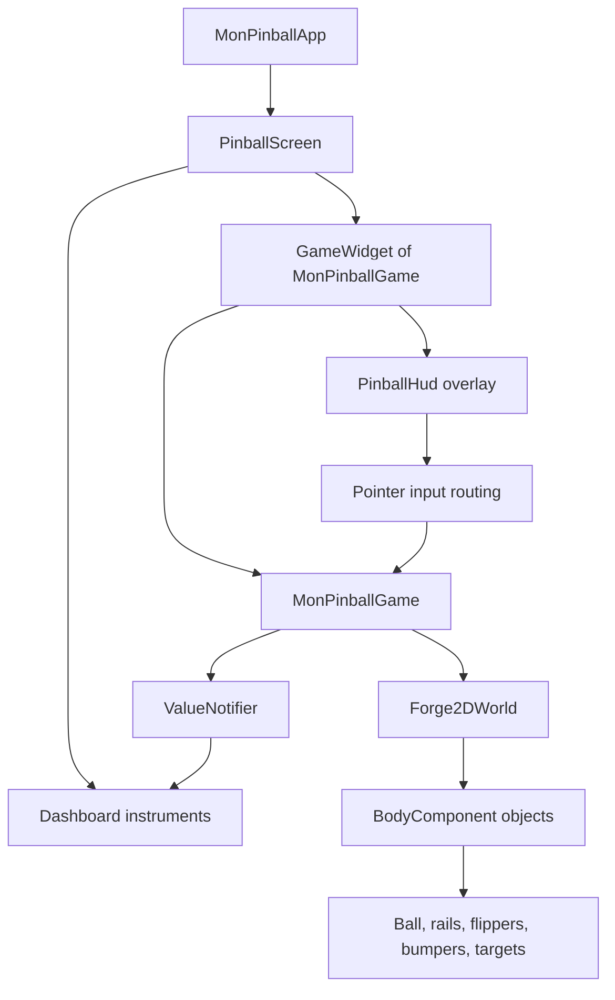
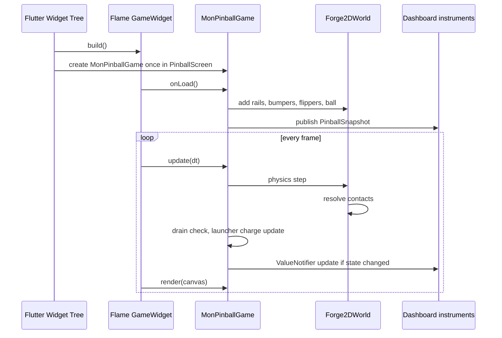
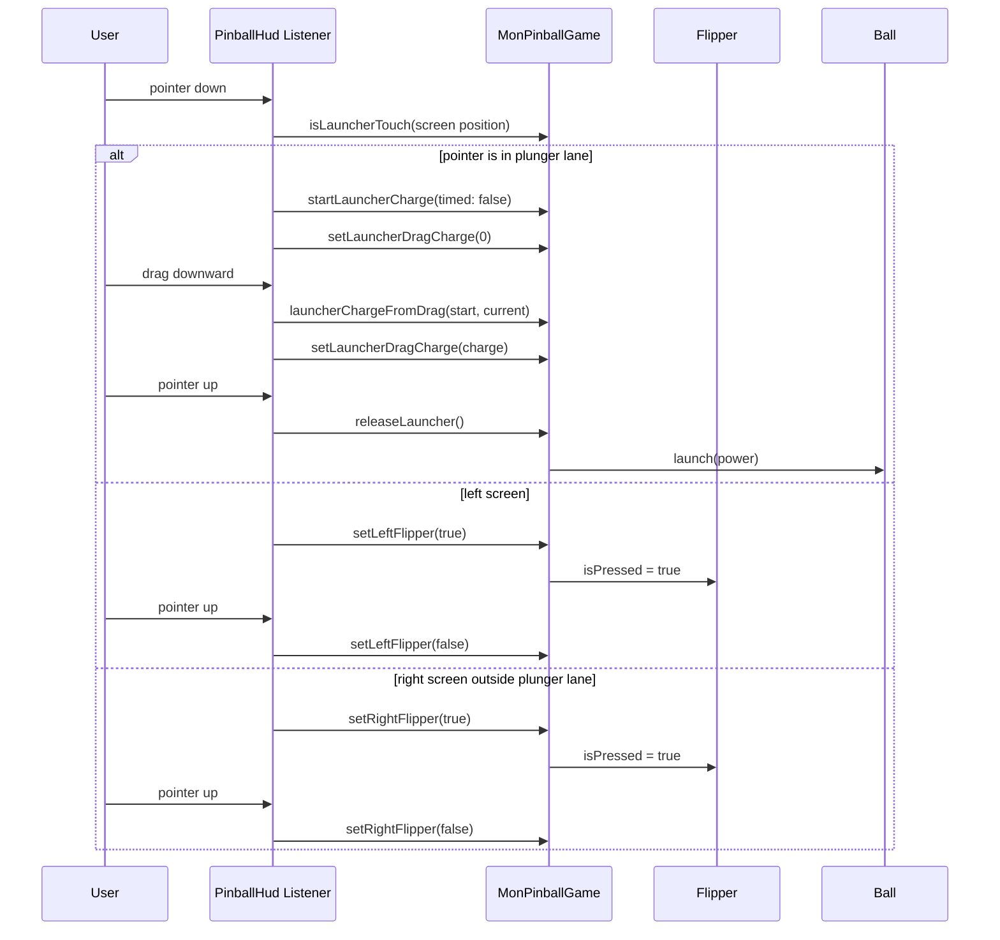
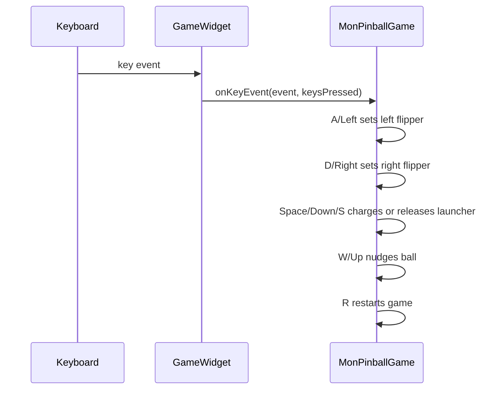
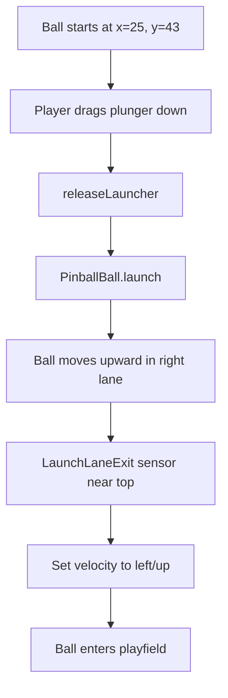
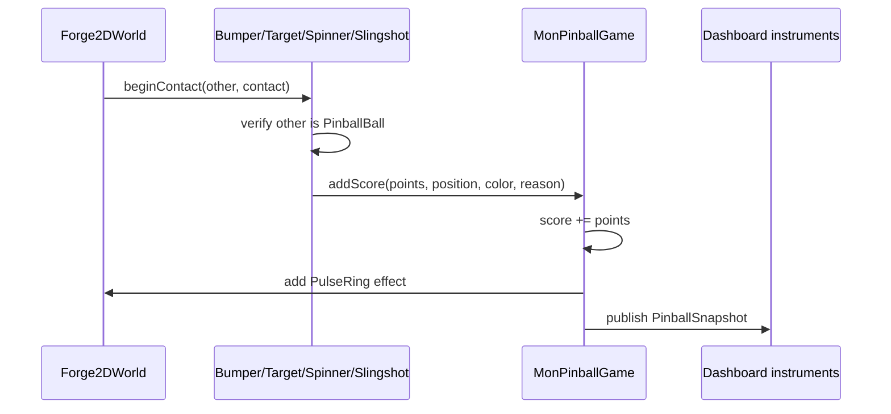
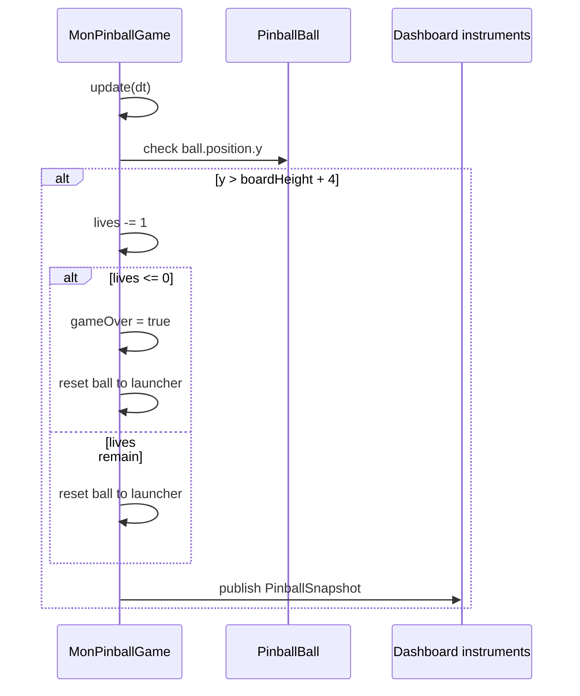

# Mon Pinball

[English](README.md) | [한국어](README.ko.md)

A small pinball game built with Flutter, Flame, and Forge2D. Flutter handles
the app shell, touch input, and the heads-up display (HUD): score, remaining
balls, status, and launch charge. Flame/Forge2D handle the game loop and
physics world.

## Run

```sh
flutter pub get
flutter run
```

## Controls

- Touch left side: left flipper
- Touch right side outside the plunger lane: right flipper
- Drag the right plunger lane downward, then release to shoot
- Keyboard: `A`/left arrow, `D`/right arrow, `Space`/down arrow to launch, `W`/up arrow to nudge, `R` to restart

## Visual Design

The Orbital Cadet design uses a brown lacquer playfield, chrome rails and
hardware, yellow/red/cyan obstacles, and an amber 5×7 dot score. The product
name remains Mon Pinball. All table art uses the existing Canvas renderer;
physics shapes, scoring, and controls are unchanged. The static backdrop is
recorded once and reused between frames.

Portrait uses a compact title/ball-count row, a centered score strip, and
a thin status/charge row so the table fills the available width. Flipper
hints are a single text row. Wide windows and phone landscape layouts
place the instruments on the right. The game stays mounted
across layout changes, and touch coordinates remain local to the table.
On short screens or with large text, the instruments scroll within their
allocated space so the table stays visible and usable.
Status text wraps, the score keeps at least seven digits, and larger scores
scale to fit. Restart has an explicit label.

The previous `_GlassPanel` wrapped the top score, lives/status/charge, and
restart panels, plus the bottom control hint. Its translucent dark fill,
rounded corners, faint white border, and shadow gave it a glass-like style;
it did not blur the background. The current `_InstrumentPanel` uses a solid
dark fill and a thin border for the wide dashboard. Portrait uses the more
compact `_CompactDashboard` to leave room for the table.

### Fonts and License Provenance

| Use | Font and upstream source | Included license |
| --- | --- | --- |
| Title | [Rajdhani SemiBold](https://github.com/google/fonts/tree/main/ofl/rajdhani) | [Rajdhani-OFL.txt](assets/fonts/Rajdhani-OFL.txt) |
| Interface text and secondary numbers | [IBM Plex Mono Medium](https://github.com/IBM/plex) | [IBMPlexMono-LICENSE.txt](assets/fonts/IBMPlexMono-LICENSE.txt) |
| Host-side tests only | [Nanum Gothic](https://github.com/google/fonts/tree/main/ofl/nanumgothic) | [NanumGothic-OFL.txt](test/fonts/NanumGothic-OFL.txt) |

The product fonts and license files were copied unchanged from
`design/fonts/` into `assets/fonts/`. These are the font authors' notices.
Condition 2 of the included SIL Open Font License (OFL) 1.1 requires the
copyright notice and license to accompany redistributed fonts. The product
licenses are also registered as app assets in `pubspec.yaml`.

Korean uses the system sans-serif fallback. Golden tests load Nanum Gothic
from `test/fonts/` so Korean remains readable without system fonts; this
fixture is not included in the app. The ignored `design/` folder is reference
material and is not required to build or run the game.

## Checks

Run static analysis, tests, and a debug Android Application Package (APK) build:

```sh
flutter analyze
flutter test
flutter build apk --debug
```

### Test Suites

In Android Studio, select `Pinball - All Tests`, `Pinball - Controls Tests`,
or `Pinball - Golden Tests` to use the host Flutter test runner. Use the
existing `main.dart` run configuration to play the game.

Running a test file on a device displays the game only while the test runs;
it does not leave a playable game after completion. Controls tests can run
on a device. Device golden runs render the scenarios but explicitly skip
image comparisons. Use `Pinball - Golden Tests` or
`flutter test --tags golden` on the host for actual baseline comparisons.
Test fonts load only on the host, so devices need no extra test assets.

```sh
# Gherkin scenarios only
flutter test --tags gherkin

# Golden comparisons only
flutter test --tags golden

# Regenerate golden baselines after an intentional interface change
flutter test test/golden/pinball_screen_golden_test.dart --update-goldens

# Regenerate Dart widget tests after editing a .feature file
dart run build_runner build
```

The golden suite renders the real Flame/Forge2D table at `390 x 844` for the
initial instruments, a charged launcher, and game-over. It also covers a
`1280 x 800` desktop layout and a `320 x 740` narrow layout with an eight-digit
score. Bundled fonts keep text deterministic and readable. Widget tests cover
larger text, compact landscape, responsive state preservation, and launcher
input after resizing.

Score comparison goldens use the same `390 x 844` screen with eight digits
(`12,345,678`), nine digits (`123,456,789`), and the 19-digit native integer
maximum (`9,223,372,036,854,775,807`). The last sample exercises the display
boundary on Android/native Dart; it does not introduce a gameplay score cap.
The images are `pinball_score_8_digits.png`, `pinball_score_9_digits.png`, and
`pinball_score_19_digits.png` in `test/golden/goldens/`.

The Gherkin source of truth is
`test/features/pinball_controls.feature`. `bdd_widget_test` generates the
corresponding Flutter widget test, while reusable step implementations live in
`test/steps/`. The scenarios exercise the initial HUD, both touch-controlled
flippers, launcher drag/release, restart, and keyboard nudge.

## Project Structure

```text
lib/
  main.dart          Flutter app, responsive instruments, game host, touch input
  pinball_game.dart  Flame/Forge2D game, physics bodies, scoring, rendering
  pinball_style.dart Shared palette, material paints, accessible dot score

assets/
  fonts/             Product fonts and their licenses

test/
  features/          Gherkin feature and generated Flutter widget test
  fonts/             Host-only font fixtures and their licenses
  golden/            Golden tests and committed reference images
  steps/             Executable Gherkin step definitions
  support/           Shared game/widget test harness
  widget_test.dart   Responsive layout, accessibility, and input regression tests
```

## Architecture

For Android developers, `main.dart` is comparable to an Activity/Fragment
with display and input layers, while `pinball_game.dart` is comparable to a
custom game view with a physics engine.



### Layer Responsibilities

| Layer | File | Responsibility |
| --- | --- | --- |
| App shell | `lib/main.dart` | `MaterialApp`, screen setup, `GameWidget` mounting |
| Instruments | `lib/main.dart` | Responsive score/lives/status/launcher charge display outside the game viewport |
| Touch input | `lib/main.dart` | Pointer down/move/up events, launcher drag tracking, flipper press state |
| Game state | `lib/pinball_game.dart` | Score, lives, launcher charge, game over, HUD snapshots |
| Physics world | `lib/pinball_game.dart` | Forge2D gravity, bodies, fixtures, collision callbacks |
| Rendered table | `lib/pinball_game.dart` | Board background, rails, bumpers, slingshots, ball, effects |

### Display and Input Layers

The old `PinballHud` used a `Stack` to place the touch listener and visible
instruments over the game. The instruments now live outside the game
viewport: above it in portrait, or in the right sidebar for wide layouts.
This keeps them from obscuring the playfield.

`PinballHud` now contains only the touch listener. Its `LayoutBuilder`
already existed inside the old `Stack`; removing the wrapper leaves it at
the root. It provides the actual game viewport width for left/right touch
routing, while pointer positions stay local to that viewport. The game
instance stays mounted when the dashboard moves between layouts.

## Runtime Flow

Flame calls `update(dt)` and `render(canvas)` every frame. The game framework
manages scheduling and drawing, similar to Android's `Choreographer` and a
custom `View.onDraw()`.



## Main Classes

### `MonPinballGame`

`MonPinballGame` extends `Forge2DGame` and is the central game controller.

Responsibilities:

- Creates the fixed-size board world: `28 x 48`
- Owns score, lives, launcher charge, status, game-over state
- Publishes HUD data through `ValueNotifier<PinballSnapshot>`
- Handles keyboard input through Flame `KeyboardEvents`
- Builds rails, bumpers, targets, flippers, launcher, ball
- Detects drain when the ball falls below the table

Important methods:

| Method | Purpose |
| --- | --- |
| `onLoad()` | Initial world setup and component creation |
| `onGameResize()` | Fits the fixed world into the current screen |
| `update(dt)` | Per-frame launcher charge and drain detection |
| `isLauncherTouch()` | Converts screen coordinate to world coordinate and checks plunger zone |
| `launcherChargeFromDrag()` | Converts downward drag distance into charge `0.0..1.0` |
| `releaseLauncher()` | Applies launch velocity to the ball |
| `addScore()` | Updates score and spawns a pulse effect |
| `restartGame()` | Resets score/lives/ball/launcher state |

### `PinballHud`

`PinballHud` is a transparent Flutter input overlay on top of the Flame canvas.
The separate dashboard uses `ValueListenableBuilder` to redraw instruments when
`MonPinballGame.hud` changes, without covering the playfield.

`PinballHud` routes touch input:

- Left half: left flipper
- Right half outside plunger lane: right flipper
- Right plunger lane: drag launcher

Pointer input is handled in Flutter overlay code, while game actions are
delegated to `MonPinballGame`. This keeps interface concerns out of the
physics classes.

### Physics Components

Most table objects extend `BodyComponent<MonPinballGame>`. `BodyComponent` is the Flame/Forge2D bridge: it owns a Forge2D `Body`, renders it, and receives updates in the Flame component tree.

| Class | Body Type | Purpose |
| --- | --- | --- |
| `PinballBall` | dynamic | Main ball affected by gravity, impulse, collisions |
| `TableRail` | static edge | Table boundaries and lane rails |
| `Flipper` | kinematic | Player-controlled rotating flipper body |
| `Bumper` | static circle | Scores points and pushes the ball away |
| `Spinner` | static polygon | Scores points and renders spin feedback |
| `DropTarget` | static polygon | Scores target hits |
| `Slingshot` | static polygon | Triangle rebound zones near flippers |
| `LaunchLaneExit` | static sensor | Nudges launched ball from plunger lane into the playfield |
| `LauncherView` | visual only | Draws plunger track and charge position |
| `PulseRing` | visual only | Temporary score hit effect |

## Input Flow

### Touch: Flippers And Launcher



### Keyboard



## Launcher Algorithm

Mobile launcher behavior intentionally uses drag distance instead of tap duration. This makes the control feel like pulling an actual spring.

```text
onPointerDown(position):
  if position is inside launcher lane:
    remember drag start position
    set charge to 0
    mark action as launcher
  else if x is left half:
    press left flipper
  else:
    press right flipper

onPointerMove(position):
  if current action is launcher:
    startWorld = screenToWorld(dragStart)
    currentWorld = screenToWorld(position)
    charge = clamp((currentWorld.y - startWorld.y) / 6.2, 0, 1)
    update HUD charge
    update LauncherView.charge

onPointerUp:
  if current action is launcher:
    power = max(charge, 0.2)
    ball.velocity = Vector2(0, -35 - 48 * power)
    reset charge to 0
```

Why `currentWorld.y - startWorld.y`:

- In this board coordinate system, larger `y` means lower on the table.
- Pulling the finger downward increases `y`.
- That maps naturally to stronger spring tension.

## Ball Launch And Lane Exit

The launcher lane is on the right side. The ball starts near the bottom of that lane. When launched, it travels upward. The top lane is intentionally widened, and `LaunchLaneExit` acts as a sensor to push the ball left into the playfield.



The sensor does not physically block the ball because its fixture is `isSensor: true`. It detects contact and rewrites the ball velocity once, with a cooldown to avoid repeated impulses.

## Collision And Scoring

Forge2D contact callbacks are delivered through `ContactCallbacks`. Score objects mix in `ContactCallbacks` and implement `beginContact`.



Scoring safeguards:

- Bumpers, spinners, and targets use short cooldowns to prevent score spam from a single contact cluster.
- `gameOver` prevents new score updates.
- Hit effects are separate `PulseRing` components so scoring does not depend on display overlay rendering.

## Flipper Algorithm

The flippers are Forge2D kinematic bodies. They do not use a revolute joint yet. Instead, they rotate toward a target angle by setting angular velocity.

```text
update(dt):
  targetAngle = isPressed ? activeAngle : restAngle
  delta = targetAngle - currentAngle

  if abs(delta) is small:
    angularVelocity = 0
    snap transform to targetAngle if world is not locked
  else:
    angularVelocity = clamp(delta * 24, -24, 24)
```

Tradeoff:

- This is simpler and stable enough for the first version.
- A more realistic version can replace it with Forge2D `RevoluteJoint` and motor limits.

## Drain And Reset Flow



## Coordinate System

The game uses a fixed world size and adapts camera zoom to screen size.

```text
World size: 28 x 48
Origin: top-left-ish table coordinate space
x increases to the right
y increases downward
Camera: centered at board center
Zoom: min(screenWidth / 28, screenHeight / 48) * 0.96
```

This means physics tuning is independent of phone resolution. The Flutter pointer position is converted back into world coordinates when checking the launcher lane.

## Current Limitations

- Flippers are kinematic angle-driven bodies, not joint-driven motors.
- There is no sound yet.
- There are no image assets. Everything is drawn with Canvas primitives.
- Table layout is hardcoded in world coordinates.
- Golden and Gherkin suites cover rendering and player controls, but low-level
  collision scoring and drain timing still rely on the Forge2D runtime.

## Good Next Refactors

1. Split `pinball_game.dart` into `components/`, `input/`, and `state/` folders once the table grows.
2. Replace flippers with `RevoluteJoint` + motor limits for more realistic physical response.
3. Add sound effects through `flame_audio`.
4. Add deterministic Forge2D component tests around collision scoring and
   drain/reset timing.
5. Extract table coordinates into a data object so levels can be tuned without editing component code.

## Initial Commit Checklist

```sh
flutter analyze
flutter test
git init
git add .
git commit -m "Initial Flame pinball game"
```
